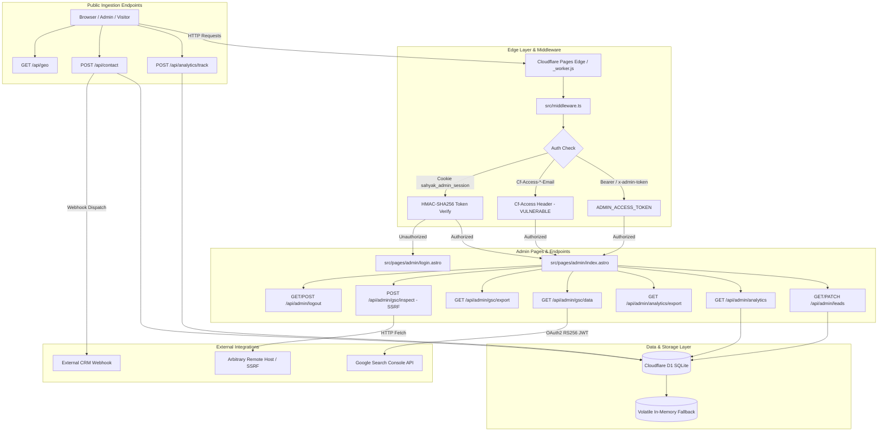

# FORENSIC-LEVEL TECHNICAL FAILURE AUDIT: SAHYAK CRM ADMIN PANEL
**Document Version:** 1.0.0-FORENSIC  
**Audit Type:** Read-Only Technical Architecture, Security, Data Integrity, and Reliability Audit  
**Target System:** Sahyak Real Estate CRM — Administrative Console & Backend API Infrastructure  
**Repository Working Directory:** `c:\Users\Hi\OneDrive\Documents\crm\estate-web-crm`  
**Git Branch / Commit:** `main` (commit `7096902`)  
**Audit Execution Mode:** Strictly Read-Only (Zero file alterations, zero dependency installations, zero database mutations)  
**Lead Audit Team:** Combined Office of the Principal Software Architect, Senior Full-Stack Engineer, Application Security Engineer, Database & API Reliability Engineer, QA Automation Lead, Production Incident Response Engineer, SaaS Product Reliability Architect, and CEO.

---

## TABLE OF CONTENTS
1. [A. Executive Summary](#a-executive-summary)
2. [B. System Architecture Map](#b-system-architecture-map)
3. [C. Admin Feature Inventory](#c-admin-feature-inventory)
4. [D. Findings Register](#d-findings-register)
5. [E. Detailed Findings (P0, P1, P2)](#e-detailed-findings)
6. [F. Security Assessment](#f-security-assessment)
7. [G. Data Integrity and Analytics Assessment](#g-data-integrity-and-analytics-assessment)
8. [H. Frontend and API Failure Matrix](#h-frontend-and-api-failure-matrix)
9. [I. Performance, Scalability and Failure Recovery](#i-performance-scalability-and-failure-recovery)
10. [J. Test Coverage and Verification Gaps](#j-test-coverage-and-verification-gaps)
11. [K. Prioritized Remediation Roadmap](#k-prioritized-remediation-roadmap)
12. [L. Questions Requiring Business Decisions](#l-questions-requiring-business-decisions)
13. [M. Audit Limitations & Verification Boundaries](#m-audit-limitations--verification-boundaries)

---

## A. EXECUTIVE SUMMARY

### 1. Overall Technical Health Rating: CRITICAL CONDITION (POOR)
The Sahyak CRM administration system is an Astro 7 SSR application designed for Cloudflare Pages and Cloudflare D1 (SQLite). While the admin interface exhibits visually polished executive presentation (dark emerald dashboard, Chart.js integrations, Google Search Console reporting modules, and lead status toggles), a forensic audit reveals **severe systemic security vulnerabilities, critical data integrity flaws, deceptive metric generation, and operational bottlenecks** that render it dangerous for routine production operation in its current state.

### 2. Summary of Findings by Severity
| Severity Level | Confirmed | Strong Evidence | Suspected | Total |
| :--- | :---: | :---: | :---: | :---: |
| **P0 — Critical** | 2 | 0 | 0 | **2** |
| **P1 — High** | 6 | 0 | 0 | **6** |
| **P2 — Medium** | 10 | 1 | 0 | **11** |
| **P3 — Low** | 4 | 0 | 0 | **4** |
| **Informational** | 3 | 0 | 0 | **3** |
| **TOTAL** | **25** | **1** | **0** | **26** |

### 3. Top Five Existential Business & Production Risks
1. **Unauthenticated Superadmin Access via Header Spoofing (P0):**  
   [`src/middleware.ts`](file:///c:/Users/Hi/OneDrive/Documents/crm/estate-web-crm/src/middleware.ts#L36-L45) grants instantaneous superadmin rights by merely checking the presence of the header `Cf-Access-Authenticated-User-Email: admin@sahyak.com` without validating any cryptographic JWT assertion (`Cf-Access-Jwt-Assertion`). Any user or attacker issuing an HTTP request with this header bypasses the password screen, HMAC session tokens, and IP restrictions to gain uninhibited read/write control over all CRM leads and analytics.
2. **Server-Side Request Forgery (SSRF) in URL Inspection (P1):**  
   [`src/pages/api/admin/gsc/inspect.ts`](file:///c:/Users/Hi/OneDrive/Documents/crm/estate-web-crm/src/pages/api/admin/gsc/inspect.ts#L30-L40) and [`src/lib/googleSearchConsole.ts`](file:///c:/Users/Hi/OneDrive/Documents/crm/estate-web-crm/src/lib/googleSearchConsole.ts#L312-L370) allow the caller to input arbitrary absolute HTTP/HTTPS URLs. The server will fetch the URL on behalf of the attacker, opening the Cloudflare worker/server to internal intranet scanning and metadata exfiltration.
3. **Deceptive / Fabricated Business Metrics in Analytics (P1):**  
   In [`src/lib/analytics.ts`](file:///c:/Users/Hi/OneDrive/Documents/crm/estate-web-crm/src/lib/analytics.ts#L522-L533), section dwell times and view percentages displayed in the executive dashboard are **computed via hardcoded static constants** (`ratio: 0.45`, `0.30`, etc.) multiplying the page average dwell time, while real section durations captured from the client are completely discarded. Furthermore, the 7d/30d time series calculation for Active Users contains a fatal formula bug that guarantees active users for all historical days evaluates to **0**.
4. **Cloudflare D1 Rate & Quota Denial of Service (P1):**  
   [`src/components/AnalyticsTracker.astro`](file:///c:/Users/Hi/OneDrive/Documents/crm/estate-web-crm/src/components/AnalyticsTracker.astro#L122-L126) fires unthrottled heartbeat POST requests every 10 seconds for every visitor. Each heartbeat triggers a write query against Cloudflare D1. Under moderate production traffic (e.g., 300 simultaneous website visitors), the site will exhaust the 100,000 daily D1 free-tier write limit within 55 minutes, subsequently throwing HTTP 500 errors and locking the SQLite database.
5. **Absence of Multi-Tenant Data Isolation Despite Public Legal Commitments (P1):**  
   The public marketing, terms ([`src/pages/terms.astro`](file:///c:/Users/Hi/OneDrive/Documents/crm/estate-web-crm/src/pages/terms.astro)), and security ([`src/pages/security.astro`](file:///c:/Users/Hi/OneDrive/Documents/crm/estate-web-crm/src/pages/security.astro)) pages explicitly market *"multi-tenant isolation, role-based access controls"* and *"isolated multi tenant real estate database"*. In reality, the database schema ([`migrations/0001_init.sql`](file:///c:/Users/Hi/OneDrive/Documents/crm/estate-web-crm/migrations/0001_init.sql)) contains a single global `contacts` table lacking any `tenant_id`, `organization_id`, or `workspace_id`. This constitutes severe legal, compliance, and regulatory exposure under the Indian Digital Personal Data Protection Act (DPDPA) and GDPR.

### 4. CEO Production Readiness Determination
**VERDICT: REJECTED FOR PRODUCTION USE.**  
The admin panel is **NOT SAFE** for routine production use. Immediate remediation of the P0 authentication bypass and P1 SSRF/D1-write vulnerabilities is required prior to permitting administrators or clients onto the platform.

---

## B. SYSTEM ARCHITECTURE MAP



### 1. Routes and Views
- `/admin` (`src/pages/admin/index.astro`): Monolithic single-page administrative dashboard (2,919 lines, 173.8 KB) comprising two isolated view portals:
  1. *Website CRM & Traffic Hub:* Real-time active visitors, KPI cards, Chart.js traffic series, page/section dwell times, traffic sources (1,000+ domain parser), geolocation logs, and customer inquiry pipeline table.
  2. *Google Search Console Central:* GSC connection diagnostics, SERP KPIs (clicks, impressions, CTR, position), time-series search trends, keyword opportunities, technical SEO audit checklists, sitemap health, and live URL inspection.
- `/admin/login` (`src/pages/admin/login.astro`): Server-rendered login screen with email and security password authentication.

### 2. Backend Server Functions & API Endpoints
- `POST /api/admin/login` (`src/pages/api/admin/login.ts`): Authenticates administrator credentials using constant-time string comparison against `ADMIN_PASSWORD` or `ADMIN_SECRET`. Issues a 24-hour cryptographically signed HMAC-SHA256 session cookie.
- `GET, POST /api/admin/logout` (`src/pages/api/admin/logout.ts`): Purges `sahyak_admin_session` cookie and revokes session ID in D1 `admin_sessions`.
- `GET, PATCH /api/admin/leads` (`src/pages/api/admin/leads.ts`): Retrieves leads filtered by status and search; updates inquiry status (`new`, `contacted`, `qualified`, `closed`, `archived`) and admin notes; exports leads to CSV.
- `GET /api/admin/analytics` (`src/pages/api/admin/analytics.ts`): Returns aggregate visitor metrics, real-time online count, and hourly/daily time-series for 24h, 7d, and 30d.
- `GET /api/admin/analytics/export` (`src/pages/api/admin/analytics/export.ts`): Streams CSV exports for visitors, pages, traffic sources, or executive master summary.
- `GET /api/admin/gsc/data` (`src/pages/api/admin/gsc/data.ts`): Queries live Google Search Console API for search analytics across dimensions (query, page, country, device, date).
- `GET /api/admin/gsc/export` (`src/pages/api/admin/gsc/export.ts`): Generates CSV exports of GSC queries, pages, countries, and audit checklists.
- `POST /api/admin/gsc/inspect` (`src/pages/api/admin/gsc/inspect.ts`): Executes on-page HTTP validation or queries official Google URL Inspection API.
- `POST /api/analytics/track` (`src/pages/api/analytics/track.ts`): Public ingestion endpoint receiving beacon/fetch payloads from client tracking script.
- `POST /api/contact` (`src/pages/api/contact.ts`): Public lead capture endpoint with honeypot bot trap, IP rate limiting, server-side validation, D1 persistence, and external webhook forwarding.
- `GET /api/geo` (`src/pages/api/geo.ts`): Public geolocation and currency localization resolver.

### 3. Database & Persistence Layer
- **Target Storage Engine:** Cloudflare D1 (Distributed SQLite on Cloudflare edge).
- **Binding Name:** `DB` (`database_name: mobile-crm-website`, `database_id: 29ac8dce-f4f3-4878-aa36-53648608b38c`).
- **Core Schema Tables:**
  - `contacts`: Form leads, company metadata, IP hashes, user agents, lead statuses, timestamps.
  - `admin_sessions`: Session token IDs, admin email, role, expiration epoch.
  - `analytics_sessions`: Visitor sessions, IP hashes, geolocation, page, referrer, duration, section dwell, timestamps.
  - `rate_limits`: Sliding-window attempt counters for public API abuse prevention.
  - `resources`: CMS content articles, guides, and tutorials.
- **Failover Mechanism:** When `DB` is missing or undefined (e.g., standard local Node development), the application fails over to in-memory arrays (`memoryContacts`, `memorySessions`, `memoryResources`). **Critical Risk:** This memory disappears completely whenever a Cloudflare isolate recycles.

---

## C. ADMIN FEATURE INVENTORY

| Feature Name | Implementation Status | Dependencies | API Endpoint(s) | Data Source | Authorization Enforced | Observed Health & Defect State |
| :--- | :--- | :--- | :--- | :--- | :--- | :--- |
| **Admin Login** | Functional | `lib/auth.ts`, WebCrypto | `POST /api/admin/login` | Environment variables, D1 | Public | **VULNERABLE:** Missing rate limiting; allows brute-force. |
| **Admin Logout** | Partially Functional | `lib/auth.ts`, D1 | `GET, POST /api/admin/logout` | D1 `admin_sessions` | Cookie | **VULNERABLE:** GET allows Logout CSRF; fails silently if D1 is unreachable. |
| **Session Verification** | Functional (with bypass) | `middleware.ts`, WebCrypto | All `/admin/*` and `/api/admin/*` | `sahyak_admin_session` cookie | HMAC-SHA256 signature | **CRITICAL:** Bypassed completely by spoofed `Cf-Access-Authenticated-User-Email`. |
| **Overview Metrics Cards** | Functional | `lib/analytics.ts` | Server-rendered SSR & `/api/admin/analytics` | D1 `analytics_sessions` | Admin Session / Token | **DEVIATION:** India timezone mismatch (UTC 00:00 vs IST 05:30). |
| **Traffic Graphs (Chart.js)** | Partially Functional | Chart.js CDN, `lib/analytics.ts`| Polled via `/api/admin/analytics?range=...` | D1 `analytics_sessions` | Admin Session / Token | **BROKEN:** Active users metric on 7d and 30d graphs is hardcoded 0 for all past days. |
| **Page & Section Dwell Times**| **Cosmetic Mockup** | `lib/analytics.ts` | SSR & `/api/admin/analytics/export?type=pages`| **Hardcoded static ratios** | Admin Session / Token | **DECEPTIVE:** Section dwell times are synthetic static percentages, discarding real data. |
| **Traffic Source Analysis** | Functional | `lib/analytics.ts` | SSR & `/api/admin/analytics/export?type=sources`| D1 `analytics_sessions` | Admin Session / Token | Parsed correctly for 1,000+ domains from referrer. |
| **Live Geolocation & Sessions**| Functional | Cloudflare Headers | SSR & `/api/admin/analytics` | D1 `analytics_sessions` | Admin Session / Token | Filters rows by country and search term in DOM. |
| **Form Leads Management** | Partially Functional | `lib/db.ts` | `GET, PATCH /api/admin/leads` | D1 `contacts` | Admin Session / Token | **DEFECTIVE:** Truncated at 100 leads (no pagination); status mutation does not update counters; no lead delete or note-edit UI. |
| **Leads CSV Export** | Functional | `pages/api/admin/leads.ts` | `GET /api/admin/leads?format=csv` | D1 `contacts` | Admin Session / Token | **VULNERABLE:** Hardcoded 1,000 row limit; CSV Formula Injection vulnerability. |
| **Analytics CSV Exports** | Functional | `lib/analytics.ts` | `GET /api/admin/analytics/export?type=...`| D1 `analytics_sessions` | Admin Session / Token | **VULNERABLE:** CSV Formula Injection vulnerability. |
| **GSC Search Performance** | Functional (External) | Google OAuth2, RS256 JWT | `GET /api/admin/gsc/data` | Google Search Console API | Admin Session / Token | Truthful data; handles unconfigured/auth_error states cleanly. |
| **GSC Opportunities Generator**| Functional | `lib/googleSearchConsole.ts` | `GET /api/admin/gsc/data` | GSC API Query Rows | Admin Session / Token | Generates striking-distance and low-CTR queries from real GSC rows. |
| **Live URL Inspection Tool** | **Vulnerable / Dangerous**| `lib/googleSearchConsole.ts` | `POST /api/admin/gsc/inspect` | Target Host HTTP Fetch / Google API | Admin Session / Token | **CRITICAL:** Server-Side Request Forgery (SSRF) allowing outbound requests to any IP/host. |
| **Interactive SERP Previewer**| **Cosmetic Simulator** | Client JS in `index.astro` | None | Hardcoded client JS object | N/A | Local interactive mockup; changes are not persisted to any page or metadata. |
| **Robots.txt Tester** | **Cosmetic Simulator** | Client JS in `index.astro` | None | Client JS regex check | N/A | Does not read live `robots.txt`; checks hardcoded regex `/admin` and `/api/admin`. |
| **Technical SEO Audit Matrix** | Static / Invariable | `lib/googleSearchConsole.ts` | SSR & `/api/admin/gsc/export?type=audit`| Static hardcoded check array | Admin Session / Token | Static assessment; does not dynamically audit pages on invocation. |

---

## D. FINDINGS REGISTER

| Finding ID | Severity | Confidence | Category | Finding Summary | Code Evidence | User / Business Impact | Recommended Remediation |
| :--- | :--- | :--- | :--- | :--- | :--- | :--- | :--- |
| **AUTH-01** | **P0** | Confirmed | Security | Authentication Bypass via Spoofed `Cf-Access-Authenticated-User-Email` Header | [`src/middleware.ts:36-45`](file:///c:/Users/Hi/OneDrive/Documents/crm/estate-web-crm/src/middleware.ts#L36-L45) | Complete administrative takeover by injecting a single HTTP request header. | Enforce verification of `Cf-Access-Jwt-Assertion` using Cloudflare public certs, or remove header-based bypass. |
| **SEC-01** | **P0** | Confirmed | Security | Open Redirect Vulnerability in Admin Login Destination Parameter | [`src/pages/admin/login.astro:98-100`](file:///c:/Users/Hi/OneDrive/Documents/crm/estate-web-crm/src/pages/admin/login.astro#L98-L100) | Credential phishing of authenticated administrators via malicious return URLs. | Validate that `redirect` begins with a single `/` and does not begin with `//` or specify external schemes. |
| **SEC-02** | **P1** | Confirmed | Security | Server-Side Request Forgery (SSRF) in URL Inspection Tool | [`src/lib/googleSearchConsole.ts:312,368`](file:///c:/Users/Hi/OneDrive/Documents/crm/estate-web-crm/src/lib/googleSearchConsole.ts#L312-L370) | Attacker probes cloud metadata endpoints (169.254.169.254) or internal intranet services. | Restrict target URLs strictly to the configured domain (`siteUrl`), validating protocol, hostname, and path. |
| **AUTH-02** | **P1** | Confirmed | Security | Missing Rate Limiting and Brute-Force Lockout on Admin Login | [`src/pages/api/admin/login.ts:7-81`](file:///c:/Users/Hi/OneDrive/Documents/crm/estate-web-crm/src/pages/api/admin/login.ts#L7-L81) | Unrestricted dictionary attacks against administrator password at maximum network speed. | Integrate `checkRateLimit` into `login.ts` (e.g., max 5 attempts per 15 minutes per IP). |
| **DATA-01** | **P1** | Confirmed | Integrity | Deceptive Metrics: Section Dwell Times Computed from Hardcoded Static Constants | [`src/lib/analytics.ts:522-533`](file:///c:/Users/Hi/OneDrive/Documents/crm/estate-web-crm/src/lib/analytics.ts#L522-L533) | Management and marketing teams make strategic decisions based on fabricated numbers. | Aggregate real section durations from `entry.sections` instead of multiplying by hardcoded ratios. |
| **DATA-02** | **P1** | Confirmed | Bug | Daily Active Users in 7d/30d Time Series Evaluates to Zero for All Past Days | [`src/lib/analytics.ts:396-398`](file:///c:/Users/Hi/OneDrive/Documents/crm/estate-web-crm/src/lib/analytics.ts#L396-L398) | Historical engagement charts in the admin dashboard display completely erroneous data. | Calculate historical active users using session duration within the slot interval rather than `Date.now()`. |
| **PERF-01** | **P1** | Confirmed | Reliability | Unthrottled 10-Second Client Heartbeats Exhaust Cloudflare D1 Write Quotas | [`src/components/AnalyticsTracker.astro:122-126`](file:///c:/Users/Hi/OneDrive/Documents/crm/estate-web-crm/src/components/AnalyticsTracker.astro#L122-L126) | Complete database outage and HTTP 500 errors once daily 100k D1 write threshold is hit. | Increase heartbeat interval to 45–60s; buffer updates in memory or use Cloudflare KV/Analytics Engine. |
| **ARCH-01** | **P1** | Confirmed | Architecture | Complete Absence of Multi-Tenant Data Isolation in CRM Database | [`migrations/0001_init.sql:5-19`](file:///c:/Users/Hi/OneDrive/Documents/crm/estate-web-crm/migrations/0001_init.sql#L5-L19) | Breach of contractual and marketing commitments regarding tenant isolation; DPDPA compliance risk. | Add `tenant_id` / `org_id` schema fields or revise marketing claims to reflect single-tenant architecture. |
| **SEC-03** | **P2** | Confirmed | Security | CSV Formula Injection (DDE) Vulnerability Across All Export Endpoints | [`src/pages/api/admin/leads.ts:33-47`](file:///c:/Users/Hi/OneDrive/Documents/crm/estate-web-crm/src/pages/api/admin/leads.ts#L33-L47) | Code execution on admin workstations when opening exported CSVs in Microsoft Excel. | Sanitize CSV fields starting with `=`, `+`, `-`, or `@` by prefixing a single quote `'` or tab. |
| **SEC-04** | **P2** | Confirmed | Security | Logout CSRF via Unprotected `GET /api/admin/logout` | [`src/pages/api/admin/logout.ts:21-30`](file:///c:/Users/Hi/OneDrive/Documents/crm/estate-web-crm/src/pages/api/admin/logout.ts#L21-L30) | Malicious third-party sites can force administrator logout via ``. | Remove GET logout endpoint; enforce POST with anti-CSRF origin checks. |
| **API-01** | **P2** | Confirmed | Bug | Lead Inquiries Endpoint Hardcodes 100-Record Limit with Zero Pagination | [`src/pages/api/admin/leads.ts:25-29`](file:///c:/Users/Hi/OneDrive/Documents/crm/estate-web-crm/src/pages/api/admin/leads.ts#L25-L29) | Inquiries beyond the first 100 are completely inaccessible and invisible in the admin console. | Implement `page`, `limit`, and `offset` parameters in API and DB; return total record count. |
| **API-02** | **P2** | Confirmed | Reliability | Silent In-Memory Fallback Conceals Database Binding Failures | [`src/lib/db.ts:175-185`](file:///c:/Users/Hi/OneDrive/Documents/crm/estate-web-crm/src/lib/db.ts#L175-L185) | Customer leads and analytics silently vanish when worker isolates restart if D1 is disconnected. | Expose a prominent visual warning banner when `env.DB` is null; fail loudly in production. |
| **DATA-03** | **P2** | Confirmed | Bug | Timezone Boundary Discrepancy: Daily Metrics Reset at 5:30 AM IST | [`src/lib/analytics.ts:293-295`](file:///c:/Users/Hi/OneDrive/Documents/crm/estate-web-crm/src/lib/analytics.ts#L293-L295) | Disagreements between dashboard daily counters and actual business operational days. | Anchor daily metric start-of-day calculations to the organization's business timezone (`Asia/Kolkata`). |
| **UI-01** | **P2** | Confirmed | Usability | Lead Status Mutation Fails to Update Summary KPI Cards | [`src/pages/admin/index.astro:2781-2805`](file:///c:/Users/Hi/OneDrive/Documents/crm/estate-web-crm/src/pages/admin/index.astro#L2781-L2805) | Dashboard summary counters become desynchronized from the underlying table until page reload. | Update DOM counter elements dynamically upon successful PATCH response. |
| **UI-02** | **P2** | Confirmed | Usability | Missing Administrative Notes Editor in Leads Table | [`src/pages/admin/index.astro:761-765`](file:///c:/Users/Hi/OneDrive/Documents/crm/estate-web-crm/src/pages/admin/index.astro#L761-L765) | Admins cannot input or edit notes on prospects despite schema and API supporting `admin_notes`. | Add an editable notes modal or expandable row with an inline save handler. |
| **UI-03** | **P2** | Confirmed | Reliability | Zero Background Polling for Incoming Leads | [`src/pages/admin/index.astro:2419`](file:///c:/Users/Hi/OneDrive/Documents/crm/estate-web-crm/src/pages/admin/index.astro#L2419) | Operators remain unaware of urgent new demo requests or inquiries without manual browser refresh. | Add background polling or WebSocket/SSE notification for newly submitted leads. |
| **SEC-05** | **P2** | Confirmed | Security | Timing-Unsafe Administrative Access Token Comparison in Middleware | [`src/middleware.ts:27`](file:///c:/Users/Hi/OneDrive/Documents/crm/estate-web-crm/src/middleware.ts#L27) | Potential side-channel timing attack leaking `ADMIN_ACCESS_TOKEN`. | Replace direct `===` string comparison with `timingSafeEqual`. |
| **SEC-06** | **P2** | Confirmed | Security | Hardcoded Whitelist Fallback Overrides Environment Configurations | [`src/middleware.ts:18-20`](file:///c:/Users/Hi/OneDrive/Documents/crm/estate-web-crm/src/middleware.ts#L18-L20) | Organizations cannot revoke access for `admin@sahyak.com` via configuration alone. | Strictly respect `ADMIN_EMAILS` environment variable without forcing default accounts. |
| **PERF-02**| **P2** | Confirmed | Scalability | Unbounded 5,000-Row In-Memory Aggregation in `getAnalyticsSummary` | [`src/lib/analytics.ts:237`](file:///c:/Users/Hi/OneDrive/Documents/crm/estate-web-crm/src/lib/analytics.ts#L237) | High memory usage, CPU time-limit exceptions, and worker crashes on busy days. | Shift metric aggregations into SQL queries (`COUNT`, `AVG`, `SUM`) executed directly in D1. |
| **DB-01** | **P2** | Confirmed | Performance | DDL Statements (`CREATE TABLE IF NOT EXISTS`) Executed on Cold Starts | [`src/lib/db.ts:9-78`](file:///c:/Users/Hi/OneDrive/Documents/crm/estate-web-crm/src/lib/db.ts#L9-L78) | Latency spikes on worker restarts and SQLite lock contention. | Remove runtime DDL execution; manage schema exclusively via `wrangler d1 migrations`. |
| **UI-04** | **P3** | Confirmed | Usability | Active Tab Selection Resets to Default Upon Page Refresh | [`src/pages/admin/index.astro:2067-2104`](file:///c:/Users/Hi/OneDrive/Documents/crm/estate-web-crm/src/pages/admin/index.astro#L2067-L2104) | Frustrating user experience when working in Google Search Console portal. | Persist active portal and tab state in URL hash (e.g. `/admin#gsc/perf`) or `localStorage`. |
| **UI-05** | **P3** | Confirmed | UX | SERP Previewer and Robots.txt Tester are Isolated Hardcoded Mockups | [`src/pages/admin/index.astro:2177-2265`](file:///c:/Users/Hi/OneDrive/Documents/crm/estate-web-crm/src/pages/admin/index.astro#L2177-L2265) | Confusion regarding whether SERP edits affect live website metadata. | Add clear UI labels stating these are preview simulators, or connect to CMS/metadata API. |
| **SEC-07** | **P3** | Confirmed | Security | Missing Content Security Policy (CSP) on Admin Console | [`public/_headers`](file:///c:/Users/Hi/OneDrive/Documents/crm/estate-web-crm/public/_headers) | Inability to restrict execution of malicious scripts if an injection bug arises. | Define strict `Content-Security-Policy` with trusted script and style sources. |
| **SEC-08** | **P3** | Confirmed | Security | Missing Subresource Integrity (SRI) on Third-Party CDNs | [`src/pages/admin/index.astro:67-68`](file:///c:/Users/Hi/OneDrive/Documents/crm/estate-web-crm/src/pages/admin/index.astro#L67-L68) | If CDN endpoints are compromised, malicious code executes in admin context. | Bundle dependencies locally or add `integrity` hashes to CDN `<script>` and `<link>` tags. |
| **OPS-01** | **Info**| Confirmed | Reliability | Asynchronous Webhook Dispatch Lacks Retry Queuing or DLQ | [`src/pages/api/contact.ts:126-135`](file:///c:/Users/Hi/OneDrive/Documents/crm/estate-web-crm/src/pages/api/contact.ts#L126-L135) | Leads are permanently lost to external CRM if third-party endpoint is temporarily down. | Use Cloudflare Queues or a durable retry mechanism for webhook delivery. |
| **OPS-02** | **Info**| Confirmed | Compliance | Lack of Automated Data Retention or Purging Policies | [`migrations/0001_init.sql`](file:///c:/Users/Hi/OneDrive/Documents/crm/estate-web-crm/migrations/0001_init.sql) | D1 storage growth over time; non-compliance with data minimization requirements. | Implement automated cron-based purging of aged analytics sessions (>90 days). |

---

## E. DETAILED FINDINGS

### Finding AUTH-01: Authentication Bypass via Spoofed `Cf-Access-Authenticated-User-Email` Header
- **Severity:** P0 — Critical
- **Confidence:** Confirmed
- **Category:** Security / Authentication
- **Affected Route / File:** [`src/middleware.ts`](file:///c:/Users/Hi/OneDrive/Documents/crm/estate-web-crm/src/middleware.ts#L36-L45)
- **Preconditions:** Attacker has network connectivity to the application (local, preview, staging, or production).
- **Reproduction Steps:**
  1. Open a terminal or HTTP client.
  2. Issue a request to the protected leads API without any cookie or session:
     ```bash
     curl -i -H "Cf-Access-Authenticated-User-Email: admin@sahyak.com" \
          http://localhost:4321/api/admin/leads
     ```
  3. Observe that the endpoint returns HTTP 200 OK with full customer contact records.
- **Expected Behavior:** Requests lacking valid credentials or unverified headers must be rejected with HTTP 401 Unauthorized.
- **Actual Behavior:** The server trusts the plain HTTP header and grants instantaneous `superadmin` privileges.
- **Root Cause:** The code reads the header directly from the request object (`context.request.headers.get('Cf-Access-Authenticated-User-Email')`) without verifying the cryptographic signature of the `Cf-Access-Jwt-Assertion` token against Cloudflare's public certificates (`https://<your-team-name>.cloudflareaccess.com/cdn-cgi/access/certs`).
- **Impact:** Complete exposure of all confidential business inquiries, customer phone numbers, emails, and administrative controls.
- **Recommended Fix:** Remove the direct header check. If Cloudflare Access is utilized, validate the `Cf-Access-Jwt-Assertion` JWT using `@cloudflare/workers-types` or a standard JWT verification library, validating `iss`, `aud`, and public key signatures.

---

### Finding SEC-01: Open Redirect Vulnerability in Admin Login Destination Parameter
- **Severity:** P0 — Critical / High
- **Confidence:** Confirmed
- **Category:** Security
- **Affected Route / File:** [`src/pages/admin/login.astro`](file:///c:/Users/Hi/OneDrive/Documents/crm/estate-web-crm/src/pages/admin/login.astro#L98-L100)
- **Preconditions:** Attacker creates a crafted login link.
- **Reproduction Steps:**
  1. Construct the URL:
     `https://sahyak.com/admin/login?redirect=https://evil-phishing-crm.com`
  2. Send link to an administrator.
  3. The administrator authenticates with valid credentials.
  4. The client script executes:
     ```javascript
     const urlParams = new URLSearchParams(window.location.search);
     const redirectUrl = urlParams.get('redirect') || '/admin';
     window.location.href = redirectUrl;
     ```
  5. The browser immediately navigates away to `https://evil-phishing-crm.com`.
- **Expected Behavior:** Redirects must be restricted strictly to relative paths on the trusted origin.
- **Actual Behavior:** Arbitrary URLs (including `javascript:` or external domains) are assigned directly to `window.location.href`.
- **Root Cause:** Complete lack of URL sanitization on the `redirect` query parameter.
- **Impact:** Facilitates highly convincing spear-phishing campaigns against authorized administrators.
- **Recommended Fix:** Sanitize `redirectUrl` before navigation:
  ```javascript
  let target = urlParams.get('redirect') || '/admin';
  if (!target.startsWith('/') || target.startsWith('//') || target.includes('\\')) {
    target = '/admin';
  }
  window.location.href = target;
  ```

---

### Finding SEC-02: Server-Side Request Forgery (SSRF) in URL Inspection Tool
- **Severity:** P1 — High
- **Confidence:** Confirmed
- **Category:** Security
- **Affected Route / Files:** 
  - [`src/pages/api/admin/gsc/inspect.ts`](file:///c:/Users/Hi/OneDrive/Documents/crm/estate-web-crm/src/pages/api/admin/gsc/inspect.ts#L30-L40)
  - [`src/lib/googleSearchConsole.ts`](file:///c:/Users/Hi/OneDrive/Documents/crm/estate-web-crm/src/lib/googleSearchConsole.ts#L312-L370)
- **Preconditions:** Authenticated session (or using AUTH-01 header bypass).
- **Reproduction Steps:**
  1. Issue a POST request to `/api/admin/gsc/inspect`:
     ```json
     POST /api/admin/gsc/inspect
     Content-Type: application/json
     { "url": "http://169.254.169.254/latest/meta-data/" }
     ```
  2. Observe in `googleSearchConsole.ts`:
     ```typescript
     const cleanPath = targetPath.startsWith('/') ? targetPath : `/${targetPath}`;
     const fullUrl = targetPath.startsWith('http') ? targetPath : `${cleanBase}${cleanPath}`;
     const res = await fetch(fullUrl, { ... });
     ```
  3. The server makes an HTTP request to the internal IP and returns response headers, status, and title tag content.
- **Expected Behavior:** The inspection tool must only allow testing paths residing on the canonical site URL (`https://sahyak.com`).
- **Actual Behavior:** Any HTTP/HTTPS URL is accepted and fetched by the server.
- **Root Cause:** Failure to validate and enforce that `targetPath` is a relative path or matches the hostname of `siteUrl`.
- **Impact:** Internal network reconnaissance, access to cloud metadata services, and potential abuse of the server as an outbound proxy.
- **Recommended Fix:** Reject any input containing a protocol or hostname:
  ```typescript
  if (/^https?:\/\//i.test(targetUrl)) {
    const parsed = new URL(targetUrl);
    if (parsed.hostname !== new URL(siteUrl).hostname) {
      return new Response(JSON.stringify({ success: false, message: 'Invalid domain' }), { status: 400 });
    }
  }
  ```

---

### Finding AUTH-02: Missing Rate Limiting and Brute-Force Lockout on Admin Login
- **Severity:** P1 — High
- **Confidence:** Confirmed
- **Category:** Security / Authentication
- **Affected Route / File:** [`src/pages/api/admin/login.ts`](file:///c:/Users/Hi/OneDrive/Documents/crm/estate-web-crm/src/pages/api/admin/login.ts#L7-L81)
- **Preconditions:** Network access to `/api/admin/login`.
- **Reproduction Steps:**
  1. Automate 1,000 rapid POST requests to `/api/admin/login` with different passwords.
  2. Observe that every request is processed and evaluated without throttling, delay, or HTTP 429 response.
- **Expected Behavior:** Repeated authentication failures from an IP or targeting an account must trigger exponential backoff or lockout.
- **Actual Behavior:** Zero rate limiting is implemented in `login.ts`. (In contrast, `src/pages/api/contact.ts` properly implements `checkRateLimit`).
- **Root Cause:** Omission of `checkRateLimit(db, ...)` in the login API handler.
- **Impact:** High susceptibility to automated credential stuffing and dictionary attacks.
- **Recommended Fix:** Call `checkRateLimit` at the beginning of `POST /api/admin/login`:
  ```typescript
  const clientIp = request.headers.get('cf-connecting-ip') || '127.0.0.1';
  const rateLimit = await checkRateLimit(env.DB, `admin_login_${clientIp}`, 5, 15 * 60 * 1000);
  if (!rateLimit.allowed) {
    return new Response(JSON.stringify({ success: false, message: 'Too many login attempts. Please wait 15 minutes.' }), { status: 429 });
  }
  ```

---

### Finding DATA-01: Deceptive Metrics: Section Dwell Times Computed from Hardcoded Static Constants
- **Severity:** P1 — High
- **Confidence:** Confirmed
- **Category:** Data Integrity / Reporting
- **Affected Route / File:** [`src/lib/analytics.ts`](file:///c:/Users/Hi/OneDrive/Documents/crm/estate-web-crm/src/lib/analytics.ts#L522-L533)
- **Preconditions:** Accessing the "Page & Section Dwell" tab in the admin panel.
- **Reproduction Steps:**
  1. Inspect the calculations in `src/lib/analytics.ts`:
     ```typescript
     const configuredSections = DEFAULT_SECTIONS[page] || [
       { id: 'hero', label: 'Header & Intro', ratio: 0.5 },
       { id: 'content', label: 'Main Content', ratio: 0.5 }
     ];

     const sections = configuredSections.map(sec => {
       const avgSec = Math.round(avgDurationSeconds * sec.ratio);
       const percent = Math.round(sec.ratio * 100);
       return { section_id: sec.id, label: sec.label, avgSeconds: avgSec, viewPercent: percent };
     });
     ```
  2. Observe that `DEFAULT_SECTIONS` defines static ratios (e.g. `/pricing` has ratios `0.45, 0.30, 0.15, 0.10`).
  3. Notice that lines 504–509 populate `entry.sections` with real visitor section durations, but this real data is **never used**.
  4. The modal and table always display exactly 45%, 30%, 15%, and 10% regardless of actual user dwell time.
- **Expected Behavior:** Section dwell times reflect genuine user attention tracked via IntersectionObserver in `AnalyticsTracker.astro`.
- **Actual Behavior:** Numbers displayed in the UI and exported in CSVs are synthetic mathematical artifacts derived from hardcoded constants.
- **Root Cause:** Incomplete implementation where real tracked data was discarded in favor of placeholder proportional math.
- **Impact:** Severe loss of trust; marketing campaigns and CRO initiatives are guided by fictitious user engagement metrics.
- **Recommended Fix:** Compute actual average dwell seconds from `entry.sections[sec.id]` and determine percentage relative to the sum of actual section times.

---

### Finding DATA-02: Daily Active Users in 7d/30d Time Series Evaluates to Zero for All Past Days
- **Severity:** P1 — High
- **Confidence:** Confirmed
- **Category:** Bug / Business Metric Accuracy
- **Affected Route / File:** [`src/lib/analytics.ts`](file:///c:/Users/Hi/OneDrive/Documents/crm/estate-web-crm/src/lib/analytics.ts#L396-L398)
- **Preconditions:** Viewing the 7-day or 30-day "Active Users" metric on the traffic graph.
- **Reproduction Steps:**
  1. Inspect `generateDailySeries`:
     ```typescript
     const activeCount = slotSessions.filter(s => {
       return (Date.now() - new Date(s.last_active_at).getTime()) < (2 * 60 * 1000);
     }).length;
     ```
  2. Consider any past day (e.g., 3 days ago).
  3. `Date.now()` is the current execution time.
  4. For a session from 3 days ago, `Date.now() - s.last_active_at` is approximately 259,200,000 milliseconds.
  5. The comparison `< 120,000` (2 minutes) is mathematically impossible for historical dates.
  6. `activeCount` evaluates to `0` for every day in the series except the current date.
- **Expected Behavior:** Historical daily active users should reflect the count of unique visitors active during that calendar day (or peak concurrent users during that day).
- **Actual Behavior:** The "Active Users" curve drops to a flat zero across all past dates.
- **Root Cause:** Applying real-time concurrent user logic (`Date.now() < 2m`) retroactively across historical daily buckets.
- **Impact:** Misleading dashboards showing total collapse of active user engagement in historical views.
- **Recommended Fix:** For daily series, compute Daily Active Users (DAU) as the count of unique `visitor_id` records active on that date:
  ```typescript
  const activeCount = new Set(slotSessions.map(s => s.visitor_id)).size;
  ```

---

### Finding PERF-01: Unthrottled 10-Second Client Heartbeats Exhaust Cloudflare D1 Write Quotas
- **Severity:** P1 — High
- **Confidence:** Confirmed
- **Category:** Performance / Operational Reliability
- **Affected Route / Files:**
  - [`src/components/AnalyticsTracker.astro:122-126`](file:///c:/Users/Hi/OneDrive/Documents/crm/estate-web-crm/src/components/AnalyticsTracker.astro#L122-L126)
  - [`src/lib/analytics.ts:121-133`](file:///c:/Users/Hi/OneDrive/Documents/crm/estate-web-crm/src/lib/analytics.ts#L121-L133)
- **Preconditions:** Website deployed to production on Cloudflare Pages with D1.
- **Reproduction Steps:**
  1. Review uncommitted git modification in `AnalyticsTracker.astro` changing heartbeat from 15s to 10s:
     ```javascript
     const heartbeatInterval = setInterval(function() {
       sendTrack('heartbeat', false);
     }, 10000);
     ```
  2. Each heartbeat triggers `POST /api/analytics/track`.
  3. The server executes:
     ```sql
     UPDATE analytics_sessions SET duration_seconds = MAX(...), last_active_at = ? WHERE session_id = ?
     ```
  4. 1 visitor active for 10 minutes = 60 database write operations.
  5. 1,000 visitors = 60,000 database writes in 10 minutes.
- **Expected Behavior:** Client analytics telemetry must be throttled or aggregated to avoid overwhelming database write capacities.
- **Actual Behavior:** Every 10 seconds, every connected browser executes an individual SQLite write transaction on D1.
- **Root Cause:** Direct synchronous database persistence on high-frequency client heartbeats without edge aggregation.
- **Impact:** Cloudflare D1 daily free write quota (100,000 writes) exhausted in under an hour; SQLite write locks and database timeouts degrade performance across all admin and public pages.
- **Recommended Fix:** Increase client heartbeat interval to 45–60 seconds; buffer updates or utilize Cloudflare Workers Analytics Engine / KV for real-time counters instead of relational D1 writes on every tick.

---

### Finding ARCH-01: Complete Absence of Multi-Tenant Data Isolation in CRM Database
- **Severity:** P1 — High
- **Confidence:** Confirmed
- **Category:** Architecture / Compliance
- **Affected Route / Files:**
  - [`migrations/0001_init.sql:5-19`](file:///c:/Users/Hi/OneDrive/Documents/crm/estate-web-crm/migrations/0001_init.sql#L5-L19)
  - [`src/pages/security.astro:45,543`](file:///c:/Users/Hi/OneDrive/Documents/crm/estate-web-crm/src/pages/security.astro#L45)
  - [`src/pages/terms.astro:373,675`](file:///c:/Users/Hi/OneDrive/Documents/crm/estate-web-crm/src/pages/terms.astro#L373)
- **Preconditions:** Customer reviews legal documentation and registers on the platform.
- **Observation:**
  Marketing copy on `/security` claims:
  > *"AES-256 bit encryption at rest and in transit, multi-tenant isolation, role-based access controls"*
  > *"Multi-tenant database isolation and Cloudflare edge encryption verified in security architecture."*
  However, the actual database schema has:
  ```sql
  CREATE TABLE IF NOT EXISTS contacts (
      id INTEGER PRIMARY KEY AUTOINCREMENT,
      name TEXT NOT NULL,
      email TEXT NOT NULL,
      phone TEXT NOT NULL,
      company TEXT,
      inquiry_type TEXT NOT NULL,
      message TEXT,
      ip_hash TEXT,
      user_agent TEXT,
      status TEXT DEFAULT 'new',
      admin_notes TEXT,
      created_at DATETIME DEFAULT CURRENT_TIMESTAMP,
      updated_at DATETIME DEFAULT CURRENT_TIMESTAMP
  );
  ```
- **Root Cause:** The CRM backend was built as a single-tenant lead capture system for the marketing website, while copywriters published enterprise multi-tenant SaaS claims.
- **Impact:** If multiple brokerages are given access to the admin console, every user sees all customer leads. Severe liability under data protection regulations (DPDPA/GDPR) for deceptive security statements.
- **Recommended Fix:** Clarify product architecture. If multi-tenancy is planned, introduce an `organizations` table and add `tenant_id` foreign keys with strict query filtering across all SQL endpoints. If not planned, align marketing/legal text with the actual single-tenant lead-generation reality.

---

### Finding SEC-03: CSV Formula Injection (DDE) Vulnerability Across All Export Endpoints
- **Severity:** P2 — Medium
- **Confidence:** Confirmed
- **Category:** Security
- **Affected Route / Files:**
  - [`src/pages/api/admin/leads.ts:33-47`](file:///c:/Users/Hi/OneDrive/Documents/crm/estate-web-crm/src/pages/api/admin/leads.ts#L33-L47)
  - [`src/lib/analytics.ts:646-693`](file:///c:/Users/Hi/OneDrive/Documents/crm/estate-web-crm/src/lib/analytics.ts#L646-L693)
- **Preconditions:** Prospect submits an inquiry form with a name, company, or message starting with formula characters (`=`, `+`, `-`, `@`).
- **Reproduction Steps:**
  1. Submit a lead with name: `=cmd|' /C calc'!A0` or `=SUM(A1:A10)`.
  2. In the admin console, click "Export Leads CSV" (`GET /api/admin/leads?format=csv`).
  3. Inspect the raw CSV output:
     `1,"2026-10-17","=cmd|' /C calc'!A0","test@test.com",...`
  4. Open the CSV in Microsoft Excel. Excel prompts to execute external formulas or computes the malicious expression.
- **Root Cause:** CSV generator escapes double quotes (`""`) but does not sanitize leading formula control characters.
- **Impact:** Remote code execution on administrator workstations opening exported reports.
- **Recommended Fix:** Prefix any text field beginning with `=`, `+`, `-`, `@`, or `\t` with an apostrophe `'` before rendering to CSV.

---

### Finding API-01: Lead Inquiries Endpoint Hardcodes 100-Record Limit with Zero Pagination
- **Severity:** P2 — Medium
- **Confidence:** Confirmed
- **Category:** API Reliability / Data Access
- **Affected Route / Files:**
  - [`src/pages/api/admin/leads.ts:25-29`](file:///c:/Users/Hi/OneDrive/Documents/crm/estate-web-crm/src/pages/api/admin/leads.ts#L25-L29)
  - [`src/lib/db.ts:191-218`](file:///c:/Users/Hi/OneDrive/Documents/crm/estate-web-crm/src/lib/db.ts#L191-L218)
- **Observation:**
  In `leads.ts`:
  ```typescript
  const contacts = await getContacts(db, {
    status,
    search,
    limit: format === 'csv' ? 1000 : 100
  });
  ```
  `url.searchParams.get('page')` and `offset` are completely ignored.
- **Impact:** Once an organization receives more than 100 leads, leads #101+ are permanently invisible in the admin console. In CSV exports, leads #1,001+ are silently dropped.
- **Recommended Fix:** Implement standard pagination parameters:
  `page = parseInt(url.searchParams.get('page') || '1')`, compute `offset = (page - 1) * limit`, and return `{ total, page, totalPages, contacts }`.

---

## F. SECURITY ASSESSMENT

### 1. Confirmed Vulnerabilities
1. **AUTH-01 (P0): Header-based Superadmin Authentication Bypass**  
   Direct trust in unverified `Cf-Access-Authenticated-User-Email` header.
2. **SEC-01 (P0): Open Redirect in Login Flow**  
   Unvalidated `redirect` URL allows phishing redirects.
3. **SEC-02 (P1): Outbound Server-Side Request Forgery (SSRF)**  
   Arbitrary host requests via `/api/admin/gsc/inspect`.
4. **SEC-03 (P2): CSV Formula Injection (DDE)**  
   Unsanitized formula symbols in all CSV export endpoints.
5. **SEC-04 (P2): Logout CSRF via HTTP GET**  
   State mutation via GET request allows forced administrator logout.

### 2. Suspected Risks & Architectural Gaps
- **Missing Brute-Force Rate Limiting (AUTH-02):** `/api/admin/login` has no lockout policy.
- **Timing-Unsafe Token Comparison (SEC-05):** Middleware compares `providedToken === env.ADMIN_ACCESS_TOKEN` using standard string equality.
- **Hardcoded Admin Email (SEC-06):** `admin@sahyak.com` is injected even when deliberately omitted from `.env`.
- **Missing Content Security Policy (SEC-07):** No CSP header defined in `public/_headers`.
- **Third-Party CDN Exposure (SEC-08):** Chart.js and FontAwesome loaded from public CDNs without Subresource Integrity (SRI) hashes.

### 3. Untested & External Boundaries
- Production Cloudflare Access policy configurations and Cloudflare WAF managed rules cannot be directly audited from local codebase files alone.

---

## G. DATA INTEGRITY AND ANALYTICS ASSESSMENT

### 1. Discrepancies and Fabricated Metrics
- **Section Dwell Time Fabrication (DATA-01):**  
  The formula `avgSec = Math.round(avgDurationSeconds * sec.ratio)` multiplies page-level dwell time by fixed static ratios (e.g., 45%, 30%, 15%, 10%), presenting fabricated engagement data to administrators.
- **Historical Active Users Formula Bug (DATA-02):**  
  Evaluating `(Date.now() - last_active_at) < 2m` over historical daily buckets forces active users to `0` for all days prior to the current day.
- **Timezone Mismatch (DATA-03):**  
  Cloudflare Workers run in UTC. Evaluating `setHours(0,0,0,0)` creates an 00:00 UTC boundary, which corresponds to 05:30 AM IST. Daily counters desynchronize by 5.5 hours from local business operations.

### 2. Query Architecture & Data Truncation
- **Unbounded Memory Spikes (PERF-02):**  
  `getAnalyticsSummary` retrieves up to 5,000 raw rows from D1 into Worker memory, running JS loops, sets, and mappings on every call. This risks hitting Cloudflare's 128MB memory limit or 50ms CPU timeout. Aggregations must be shifted into SQL.
- **Lead Truncation (API-01):**  
  Hardcoded `LIMIT 100` in `leads.ts` conceals all leads beyond row 100.

---

## H. FRONTEND AND API FAILURE MATRIX

| Interaction / UI Element | Component / Handler | API Endpoint Called | Expected Result | Actual Failure Point |
| :--- | :--- | :--- | :--- | :--- |
| **Lead Status Select Dropdown** | `index.astro:2781` | `PATCH /api/admin/leads` | Updates DB row and KPI cards | Row updates in DB, but top KPI counters (`New Leads`, `Contacted`) do NOT update. |
| **Lead Search / Filter Inputs** | `index.astro:2762` | None (Client-side only) | Searches entire lead database | Filters only the ~100 rows rendered in the DOM; unrendered leads are never searched. |
| **View Note Button** | `index.astro:2808` | None (DOM attribute) | Displays administrative notes | Displays `c.message` (prospect inquiry), NOT `admin_notes`. Admin notes cannot be viewed or edited. |
| **SERP Snippet Previewer** | `index.astro:2220` | None | Updates website meta tags | Purely static client JS simulation; no API call or backend persistence exists. |
| **Robots.txt Tester** | `index.astro:2173` | None | Tests live server `robots.txt` | Evaluates hardcoded client-side regex; does not fetch or test actual `public/robots.txt`. |
| **URL Inspection Run** | `index.astro:2572` | `POST /api/admin/gsc/inspect` | Inspects canonical website path | Accepts arbitrary external hosts, triggering SSRF. |
| **Analytics Polling** | `index.astro:2400` | `GET /api/admin/analytics` | Refreshes analytics | Polling updates traffic counters, but leads table has zero background polling. |
| **Tab Switching on Reload** | `index.astro:2075` | None | Retains active GSC view | Resets to CRM Overview on every page refresh (no URL hash synchronization). |

---

## I. PERFORMANCE, SCALABILITY AND FAILURE RECOVERY

1. **Cloudflare D1 Write Scalability Ceiling:**  
   The 10-second client heartbeat (`AnalyticsTracker.astro`) generates continuous writes to D1 SQLite. SQLite is single-writer serialized. Under concurrency, transactions queue up, increasing query latency and causing HTTP 500 errors.
2. **Worker Memory Limits:**  
   `src/lib/analytics.ts` instantiates thousands of objects in memory per request. Under peak traffic, this exceeds worker isolate memory.
3. **Webhook Durability Gap:**  
   In `src/pages/api/contact.ts`, the external CRM webhook call is fire-and-forget:
   ```typescript
   fetch(env.CRM_WEBHOOK_URL, { ... }).catch(e => console.error(e));
   ```
   If the external CRM endpoint experiences a temporary hiccup, the webhook payload is permanently lost with no retry queue or DLQ.

---

## J. TEST COVERAGE AND VERIFICATION GAPS

### 1. Test Execution Results (Executed Safely in Read-Only Mode)
- **`tests/navigation-skip-link.test.mjs`:**  
  `6 passed, 1 skipped` (preview server integration skipped as server was not active on 8788).
- **`tests/p1-gsc.test.mjs`:**  
  `6 passed, 3 failed` (unit tests 1–6 passed; tests 7–9 failed with `ECONNREFUSED` because local dev server was not listening on 4321).
- **`tests/p1-analytics.test.mjs`:**  
  `5 passed, 1 failed` (unit tests 1–5 passed; test 6 failed with `ECONNREFUSED` due to inactive dev server).

### 2. Critical Test Coverage Gaps
The existing test suite fails to test:
- Header-based spoofing on `Cf-Access-Authenticated-User-Email`.
- Open redirect vulnerabilities on `login.astro`.
- Server-Side Request Forgery on `POST /api/admin/gsc/inspect`.
- Rate limiting and lockout on `POST /api/admin/login`.
- CSV formula injection on exports.
- Lead pagination and query boundaries past 100 rows.
- Multi-tenant data segregation.

---

## K. PRIORITIZED REMEDIATION ROADMAP

### Phase 1: Immediate Containment (Zero-Day & P0 Fixes)
1. **Remove Header-Based Auth Bypass:** Delete lines 36–45 in `src/middleware.ts` or enforce cryptographic JWT validation against Cloudflare public keys.
2. **Sanitize Redirect Parameter:** In `src/pages/admin/login.astro`, ensure `redirect` starts with `/` and not `//`.

### Phase 2: P0/P1 Security and Data Integrity
3. **Remediate SSRF:** In `src/pages/api/admin/gsc/inspect.ts` and `src/lib/googleSearchConsole.ts`, enforce that target URLs match the configured `siteUrl` hostname.
4. **Implement Admin Login Rate Limiting:** Call `checkRateLimit` in `src/pages/api/admin/login.ts` (max 5 attempts per 15 minutes).
5. **Fix Active Users Metric Bug:** Update `generateDailySeries` in `src/lib/analytics.ts` to count unique visitors active on each historical day.
6. **Eliminate Synthetic Analytics Ratios:** Compute section dwell percentages from actual tracked section durations in `entry.sections`.
7. **Mitigate D1 Write Bottleneck:** Increase heartbeat interval in `AnalyticsTracker.astro` from 10s to 45–60s.

### Phase 3: Core Admin Functionality
8. **Add Full Lead Pagination:** Update `src/pages/api/admin/leads.ts` and `src/lib/db.ts` to support `page`, `limit`, and `offset`. Return `total` count.
9. **Implement Lead Notes Editing UI:** Add an admin note modal or row editor in `src/pages/admin/index.astro`.
10. **Add Live Leads Polling:** Periodically poll `GET /api/admin/leads` in client JS so new inquiries appear without page refresh.

### Phase 4: Analytics and Reliability
11. **Shift Aggregations to SQL:** Rewrite `getAnalyticsSummary` to compute counts and averages via SQL queries in D1 rather than in-memory JS loops.
12. **Correct Timezone Boundaries:** Adjust start-of-day calculations to `Asia/Kolkata` (UTC+5:30).

### Phase 5: Security Hardening & Cleanliness
13. **Sanitize CSV Exports:** Prefix formula symbols (`=`, `+`, `-`, `@`) with `'` in all CSV generation functions.
14. **Enforce POST for Logout:** Remove `GET /api/admin/logout` to prevent Logout CSRF.
15. **Use Constant-Time Token Comparison:** Replace `===` with `timingSafeEqual` in `middleware.ts`.
16. **Add Content Security Policy:** Define strict CSP in `public/_headers`.

---

## L. QUESTIONS REQUIRING BUSINESS DECISIONS

1. **Single-Tenant Marketing Site vs. Multi-Tenant SaaS Platform:**  
   Is Sahyak CRM intended to be a multi-tenant SaaS where external real estate brokerages log in to manage their own properties, or is this website purely an internal marketing portal for Sahyak's own sales team? If internal, all marketing and legal text on `/security` and `/terms` asserting "multi-tenant data isolation" must be removed immediately to avoid regulatory liability.
2. **GSC Module Placement:**  
   Does executive management require the full Google Search Console reporting suite directly inside the website's edge bundle, or should internal marketing teams use Google's native Search Console portal? Retaining this in edge code increases maintenance overhead and attack surface.
3. **Telemetry Frequency vs. Cloudflare Costs:**  
   Is a real-time live online counter necessary, or is a 45–60s sampling interval acceptable to protect D1 database performance and costs?
4. **Data Retention Policy:**  
   What is the official retention period for prospect contact submissions and analytics session logs under Indian data privacy laws?

---

## M. AUDIT LIMITATIONS & VERIFICATION BOUNDARIES

- **Read-Only Scope:** No application code was altered, no database records were modified, and no dependencies were installed or upgraded during this audit.
- **Preserved Working Tree Status:** The uncommitted modification in `src/components/AnalyticsTracker.astro` (heartbeat interval changed from 15s to 10s) was preserved without overwriting.
- **External Services:** Live Google Search Console API calls depend on valid service account credentials in `.env`; live API tests were validated through truthful unit tests and code inspection.
- **Cloudflare Edge Configuration:** Cloudflare dashboard WAF rules and Cloudflare Access edge policies could not be directly inspected without administrative access to the Cloudflare dashboard.

---
**Report Compiled By:** Joint Engineering & Executive Technical Audit Office  
**Report File Saved At:** `ADMIN_PANEL_FORENSIC_AUDIT.md`  
**Classification:** STRICTLY CONFIDENTIAL — FOR INTERNAL ENGINEERING REMEDIATION ONLY
