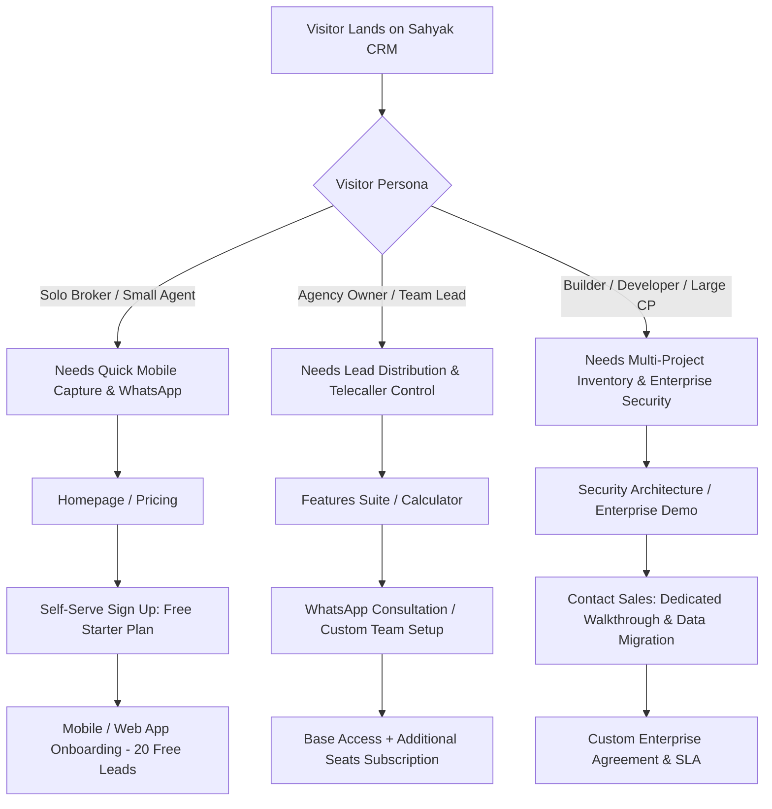

# SAHYAK CRM — COMPREHENSIVE CONTENT, BUSINESS POSITIONING & CRO AUDIT REPORT

**Document Name:** `CONTENT_BUSINESS_AUDIT.md`  
**Audit Date:** October 16, 2026  
**Auditor Roles:** Senior SaaS Product Strategist, B2B Copywriter, Conversion Rate Optimization (CRO) Expert & Website Content Auditor  
**Target Website:** [https://sahyak.com/](https://sahyak.com/)  
**Primary Working Repository:** `mayalok-ventures/real-estate-website` (`c:\Users\Hi\OneDrive\Documents\crm\estate-web-crm`)  
**Audit Protocol:** Read-Only Investigation, Evidence-Based Audit & Strategic Review  

---

## A. Executive Summary

### 1. Strategic Context & Product Positioning
Sahyak CRM is engineered as a mobile-first, multi-tenant B2B SaaS CRM tailored specifically for the real estate vertical. Its core functional purpose is to replace the chaotic, fragmented stack used daily by real estate professionals (WhatsApp personal chats, paper site diaries, Excel spreadsheets, and generic desk-bound CRMs) with a unified, pocket-accessible operating system.

The product's addressable market spans four distinct real estate stakeholder segments:
1. **Independent Real Estate Brokers & Agents** (solo operators requiring speed, instant follow-up reminders, and mobile brochure sharing).
2. **Real Estate Agencies & Brokerages** (team leads and 5–50 agents needing lead distribution, duplicate prevention, and pipeline visibility).
3. **Channel Partners (CPs)** (firms marketing multi-developer inventory requiring project collateral access and commission tracking).
4. **Property Developers & Builders** (sales managers and telecallers coordinating high-velocity inquiry flows, on-site sales galleries, and unit availability).

### 2. High-Level Audit Findings
While the technical foundation (Astro 5, compiled CSS, compressed assets, Cloudflare edge delivery) was stabilized in prior maintenance cycles, a rigorous content, CRO, and business positioning audit reveals severe strategic, legal, and conversion-killing discrepancies:

1. **Brand Positioning Identity Crisis ("Real People" vs Real Estate Operators):**
   The primary hero headline across the site pitches Sahyak as *"The Real Estate CRM Built for Real People"*. This consumer-lifestyle slogan fails to speak the language of real estate business operators. Real estate professionals do not buy CRM software because they are "real people"; they buy it to stop losing ₹50,000 to ₹5,00,000 in missed brokerage commissions, ensure telecallers call leads within 5 minutes, track site visit attendance, and share inventory instantly.
2. **Freemium Offer vs Free Trial Contradiction:**
   The site suffers from an unresolved messaging conflict regarding its entry-level offer:
   - *Homepage & Pricing Cards:* Advertise a perpetual **Free Starter Tier** (20 leads, 1 user seat, 10 WhatsApp actions, 3 listings; no credit card required).
   - *Mobile Navbar Drawer & Contact Page FAQ:* Advertise a **"14-Day Free Trial"**.  
   This creates confusion: visitors cannot tell whether the free tier is a perpetual micro-tier for solo brokers or a time-expiring trial.
3. **Legal Compliance Void (Dead Privacy & Terms Links):**
   Every page's footer includes links to `Privacy Policy` (`/security/#privacy`) and `Terms of Service` (`/security/#terms`). However, **neither anchor nor any legal text exists on `/security/` or anywhere else in the codebase**. In a B2B SaaS handling customer contact data, phone numbers, WhatsApp chats, and financial transactions under India's Digital Personal Data Protection Act (DPDPA 2023) and global privacy regimes, operating without accessible terms and privacy policies is a critical legal liability and instant enterprise deal-breaker.
4. **Deceptive Cosmetic Content & Unverifiable Social Proof:**
   - On `/resources/`, the "Video Tutorials" are static image mockups with fake duration timestamps (`5:24`, `3:18`) and unclickable play buttons. The "Templates & Downloads" (Brochure PDF, WhatsApp DOCX, Checklist XLSX) have no download links. The search bar is a non-functioning `<input>`. The schema marks up a non-existent `VideoObject`.
   - On `/about/`, leadership is listed anonymously as *"Sahyak Engineering & Real Estate Leadership"*, with zero names, bios, or verifiable company background.
   - On `/contact/`, the copy claims physical office hubs in *"San Francisco, London, Dubai & Singapore"*, directly contradicting the statement on the same page that Sahyak is a remote-first team based out of BKC Mumbai.
   - Customer trust badges across four pages use identical stock avatar placeholders from `i.pravatar.cc` and Unsplash alongside unsupported claims of *"Trusted by 10,000+ real estate professionals worldwide"* and hardcoded schema ratings (`4.9 / 148 reviews`).
5. **Bait-and-Switch CTA Routing (CRO Friction):**
   On `/features/`, every single feature deep-dive CTA ("Explore lead management ->", "Explore inventory features ->", "Explore site visit tools ->") directs users to `/contact` rather than providing detailed feature walkthroughs, UI flows, or interactive demos. Similarly, the homepage hero secondary CTA ("Watch demo") merely scrolls to `/features`.
6. **WhatsApp Pricing Ambiguity:**
   Pricing cards declare *"WhatsApp Hub included (no per-message fees)"*. While Sahyak charges zero platform markup, Meta independently levies WhatsApp conversation fees for business-initiated conversations. Omitting this distinction risks customer disputes, chargebacks, and compliance friction.

---

## B. Complete Inventory of Discovered Pages & Their Purpose

| Page / Route | Exact Source File | Page Type & Primary Purpose | Target Audience | Prerender Status |
| :--- | :--- | :--- | :--- | :--- |
| **Homepage**<br>`/` | `src/pages/index.astro` | **Hero Acquisition & Value Proposition:** Introduce Sahyak CRM, frame the industry problem (fragmented tools), highlight mobile-first capabilities, and drive Free Starter signups. | Solo Brokers, Agencies, Channel Partners, Builders | Static (`prerender = true`) |
| **Features**<br>`/features/` | `src/pages/features.astro` | **Product Capability Showcase:** Provide detailed breakdown of the 6 functional modules: Lead Capture, Tower Inventory, Site Visits, Team Permissions, WhatsApp Hub, Analytics. | Agency Owners, Sales Managers, Operations Heads | Static (`prerender = true`) |
| **Pricing**<br>`/pricing/` | `src/pages/pricing.astro` | **Commercial Model & ROI Justification:** Explain Base Access (₹499/mo), modular scale calculator, country currency selector (15 priority markets), and plan selection. | Decision Makers, Agency Principals, Financial Leads | Static (`prerender = true`) |
| **Security**<br>`/security/` | `src/pages/security.astro` | **Risk Mitigation & Technical Assurance:** Articulate data isolation (multi-tenancy), encryption standards, access control roles, and compliance posture. | Enterprise Developers, CTOs, Compliance Officers | Static (`prerender = true`) |
| **Resources**<br>`/resources/` | `src/pages/resources.astro` | **Enablement & Content Marketing:** Provide user guides, video walkthroughs, downloadable sales templates, and help center topics. | Active CRM Users, Telecallers, Onboarding Managers | Static (`prerender = true`) |
| **About Us**<br>`/about/` | `src/pages/about.astro` | **Brand Authority & Corporate Credibility:** Establish company origin, vision, leadership credibility, real estate domain expertise, and operational headquarters. | Prospective Clients, Strategic Partners, Investors | Static (`prerender = true`) |
| **Contact**<br>`/contact/` | `src/pages/contact.astro` | **Inbound Conversion & Sales Inquiry:** Capture demo requests, enterprise licensing inquiries, WhatsApp chats, and customer support tickets. | High-Intent Inbound Prospects, Enterprise Buyers | Static (`prerender = true`) |
| **Custom 404**<br>`/404` | `src/pages/404.astro` | **Traffic Retention & Error Recovery:** Guide visitors with broken or outdated links back to core commercial funnels. | All Lost Visitors | Static (`prerender = true`) |
| **Admin Login**<br>`/admin/login` | `src/pages/admin/login.astro` | **Internal Administrative Authentication:** Secure staff access to lead databases and Google Search Console performance analytics. | Internal Sahyak Operations | SSR (`prerender = false`) |
| **Admin Dashboard**<br>`/admin/` | `src/pages/admin/index.astro` | **CRM Operational Console:** Internal inquiry management, GSC traffic analytics, and session audit logs. | Internal Sahyak Administrators | SSR (`prerender = false`) |
| **Geo API**<br>`/api/geo` | `src/pages/api/geo.ts` | **Currency & Geo-Location Backend:** Resolves client IP / timezone to 15 country pricing tiers or custom quote state. | Internal Calculator Frontend | SSR (`prerender = false`) |
| **Contact API**<br>`/api/contact` | `src/pages/api/contact.ts` | **Lead Ingestion Backend:** Validates contact submissions, checks rate limits, executes honeypot spam filtering, writes to D1, and fires webhooks. | Inbound Contact Forms | SSR (`prerender = false`) |
| **Sitemap**<br>`/sitemap.xml` | `public/sitemap.xml` | **Search Indexation Index:** Lists canonical marketing routes for Googlebot, Bingbot, and AI search crawlers. | Search Engine Crawlers | Static XML |
| **Robots Directives**<br>`/robots.txt` | `public/robots.txt` | **Crawler Directives:** Directs search crawlers to public pages while disallowing `/admin/` and `/api/`. | Search & AI Crawlers | Static TXT |

---

## C. Page-by-Page Audit Table

| Page & Route | Existing Content Issue | Evidence from Current Implementation | Business & Conversion Impact | Recommended Correction | Priority |
| :--- | :--- | :--- | :--- | :--- | :---: |
| **Homepage**<br>`/` | **Generic, non-B2B headline & missing ICP callout.** "Real people" is consumer fluff that fails to identify brokers or builders. | [src/pages/index.astro:160-162](file:///c:/Users/Hi/OneDrive/Documents/crm/estate-web-crm/src/pages/index.astro#L160-L162):<br>`<h1>The Real Estate CRM Built for Real People.</h1>` | High bounce rate from commercial buyers (developers, brokerages) seeking enterprise software, not generic apps. | Replace with outcome-driven H1: *"The Mobile-First Real Estate CRM That Closes Deals Faster."* Subhead: *"Built for brokers, agencies, channel partners, and builders. Capture leads from portals and ads, automate WhatsApp follow-ups, and coordinate site visits from your phone."* | **Critical** |
| **Homepage**<br>`/` | **Misleading video demo CTA.** Button displays play icon (`▶ Watch demo`) but merely jumps to the text-heavy `/features` page. | [src/pages/index.astro:172-174](file:///c:/Users/Hi/OneDrive/Documents/crm/estate-web-crm/src/pages/index.astro#L172-L174):<br>`<a href="/features" ...><span class="text-brandGreen">&#9654;</span> Watch demo</a>` | Visitors expecting an immediate 2-minute product video experience feel misled when redirected to text features. | Change anchor text to *"Explore Features"* OR embed a real 90-second product walkthrough modal triggered by a true video player. | **High** |
| **Homepage**<br>`/` | **Fabricated social proof & placeholder avatars.** Uses stock Pravatar photos and unverifiable claims of 15+ countries without testimonials. | [src/pages/index.astro:178-184](file:///c:/Users/Hi/OneDrive/Documents/crm/estate-web-crm/src/pages/index.astro#L178-L184):<br>`src="https://i.pravatar.cc/100?img=1"` and Schema rating `4.9 / 148 reviews`. | Experienced real estate developers identify stock avatars immediately, destroying enterprise trust. | Remove Pravatar placeholders. Replace with verified broker quote with name, firm, and city (e.g. *"Rajan Sharma, Principal Broker, Apex Realty Pune"*), or state verifiable milestone metrics. | **Critical** |
| **Homepage**<br>`/` | **Weak closing CTA section.** Section 6 uses vague philosophical copy: *"Built for a bigger tomorrow. Real estate moves fast. So do we."* | [src/pages/index.astro:418-430](file:///c:/Users/Hi/OneDrive/Documents/crm/estate-web-crm/src/pages/index.astro#L418-L430):<br>`<a href="/about">Be part of the journey &rarr;</a>` | Loses high-intent visitors at the bottom of the funnel by routing them to About instead of signup or demo. | Replace with conversion closer: *"Ready to Stop Losing Deals to Missed Follow-ups? Get started with 20 free leads today. No credit card required."* CTAs: `Start Free` and `Schedule a Brokerage Demo`. | **High** |
| **Features**<br>`/features/` | **Deceptive "Bait-and-Switch" microcopy.** All 6 feature module buttons claim to explore that tool but dump users onto `/contact`. | [src/pages/features.astro:287, 341, 367, 407, 449, 474](file:///c:/Users/Hi/OneDrive/Documents/crm/estate-web-crm/src/pages/features.astro#L287):<br>`<a href="/contact">Explore lead management &rarr;</a>` | Deeply frustrates users wanting to see how inventory or site visits work, causing immediate bounce from the contact form. | Keep users on page or link to an interactive feature modal/sub-anchor. Change button labels to *"Book a demo of this feature"* or *"Start using this in Free Starter"*. | **High** |
| **Features**<br>`/features/` | **Unsubstantiated bulk messaging claim without compliance disclaimer.** Promises "send bulk messages" on WhatsApp. | [src/pages/features.astro:447](file:///c:/Users/Hi/OneDrive/Documents/crm/estate-web-crm/src/pages/features.astro#L447):<br>`send bulk messages and keep conversations organized.` | Suggests spamming is allowed; violates Meta Business Messaging policies; risks WhatsApp account bans for buyers. | Rephrase to compliant language: *"Send opt-in broadcasts, automated visit confirmations, and verified templates via official Meta WhatsApp Business API integration."* | **High** |
| **Features**<br>`/features/` | **Skipped Heading Levels & Layout Divergence.** Uses raw `<!DOCTYPE html>` rather than `<Layout.astro>`, creating styling/tag divergence. | [src/pages/features.astro:35-37](file:///c:/Users/Hi/OneDrive/Documents/crm/estate-web-crm/src/pages/features.astro#L35-L37):<br>Does not import or wrap with `Layout.astro`. | Causes inconsistent OpenGraph tags, misses standard canonical normalization, and breaks design tokens. | Wrap page in `<Layout title={...} description={...} activeNav="features">`. | **Medium** |
| **Pricing**<br>`/pricing/` | **Misleading WhatsApp fee representation.** Claims "no per-message fees" without clarifying Meta conversation charges. | [src/pages/pricing.astro:869](file:///c:/Users/Hi/OneDrive/Documents/crm/estate-web-crm/src/pages/pricing.astro#L869):<br>`WhatsApp Hub included (no per-message fees)` | Customers feel deceived when Meta bills them for business-initiated marketing conversations. | Clarify copy: *"Sahyak WhatsApp Hub included with 0% software markup. Third-party Meta API conversation rates apply directly."* | **Critical** |
| **Pricing**<br>`/pricing/` | **Starter Plan limit discrepancy.** Card obscures the "10 WhatsApp actions" limit advertised on the homepage. | [src/pages/pricing.astro:850](file:///c:/Users/Hi/OneDrive/Documents/crm/estate-web-crm/src/pages/pricing.astro#L850):<br>`Multi-channel client actions & follow-ups` | Expectation mismatch: users expect unlimited actions on Free Starter, then hit paywall after 10 messages. | Align with source of truth: *"10 automated WhatsApp messages/actions included"* explicitly on the Free Starter card. | **High** |
| **Pricing**<br>`/pricing/` | **Calculator CTA lacks direct signup path.** Calculator summary button routes to `/contact?topic=pricing` rather than onboarding. | [src/pages/pricing.astro:791](file:///c:/Users/Hi/OneDrive/Documents/crm/estate-web-crm/src/pages/pricing.astro#L791):<br>`<a href="/contact?topic=pricing">Get started with this plan &rarr;</a>` | High-intent users ready to activate a base plan face friction of a manual contact form submission. | Provide a dual choice: `Activate Plan Now &rarr;` (links to `crm.sahyak.com/checkout?plan=custom...`) or `Talk to Sales`. | **Medium** |
| **About Us**<br>`/about/` | **Anonymous leadership & zero company origin.** Founder schema lists a generic group name; zero human bios or founders listed. | [src/pages/about.astro:47-48](file:///c:/Users/Hi/OneDrive/Documents/crm/estate-web-crm/src/pages/about.astro#L47-L48):<br>`"name": "Sahyak Engineering & Real Estate Leadership"` | Serious brokerages and developers will not entrust proprietary customer lead data to an anonymous entity. | Add a transparent "Leadership & Story" section naming founders/architects, engineering background, and parent corporate context (Mayalok Ventures). | **High** |
| **About Us**<br>`/about/` | **Disorienting CTA routing.** "See who it's for ->" button routes users directly to the Pricing page. | [src/pages/about.astro:912](file:///c:/Users/Hi/OneDrive/Documents/crm/estate-web-crm/src/pages/about.astro#L912):<br>`<a href="/pricing" class="btn btn-primary">See who it's for &rarr;</a>` | Breaks user cognitive expectation; a visitor wanting to know if Sahyak fits builders is dumped into a pricing slider. | Direct to persona breakdown sections or create specific audience tabs (Brokers / CPs / Builders). | **Medium** |
| **Resources**<br>`/resources/` | **100% cosmetic mockup with zero working content.** Video player, template downloads, and search bar are all non-functional. | [src/pages/resources.astro:340-377, 479-502, 530-535](file:///c:/Users/Hi/OneDrive/Documents/crm/estate-web-crm/src/pages/resources.astro#L340-L377):<br>No `<video>` or iframe; no `href` download links; unlinked cards. | Severe credibility loss. High-intent users looking for real help find dummy UI components and bounce permanently. | Either: (A) Provide real downloadable PDFs/DOCX and embed 2-3 genuine loom/walkthrough videos, OR (B) Replace with curated practical text guides on this page. | **Critical** |
| **Resources**<br>`/resources/` | **Deceptive structured data.** Schema marks up a `VideoObject` with fake upload date (`2026-01-15`) and name when no video exists. | [src/pages/resources.astro:47-53](file:///c:/Users/Hi/OneDrive/Documents/crm/estate-web-crm/src/pages/resources.astro#L47-L53):<br>`"@type": "VideoObject"` | Google Search Console rich-result penalty risk for deceptive schema markup. | Remove `VideoObject` schema until real video assets are hosted and playable. | **High** |
| **Security**<br>`/security/` | **Missing Privacy Policy and Terms of Service.** Footer points to `/security/#privacy` and `/security/#terms`, which do not exist. | [src/components/Footer.astro:102-104](file:///c:/Users/Hi/OneDrive/Documents/crm/estate-web-crm/src/components/Footer.astro#L102-L104):<br>`<a href="/security/#privacy">Privacy Policy</a>` | Critical legal compliance violation under India DPDP Act 2023 and GDPR; blocks enterprise security vetting. | Create dedicated, comprehensive `/privacy/` and `/terms/` routes (or dedicated anchor sections on `/security/`). | **Critical** |
| **Security**<br>`/security/` | **Vague security generalities without real estate specifics.** Repetitive "bank-grade" copy lacks architectural substance. | [src/pages/security.astro:221-224](file:///c:/Users/Hi/OneDrive/Documents/crm/estate-web-crm/src/pages/security.astro#L221-L224):<br>Repetitive statements with neon glow aesthetics. | CTOs and developer IT directors require concrete details on tenant data isolation, RERA audit logs, and backup retention. | Add technical specifications: PostgreSQL/D1 schema isolation per tenant, AES-256 at rest, TLS 1.3 in transit, role-based telecaller masking, daily automated snapshots. | **Medium** |
| **Contact**<br>`/contact/` | **Free trial vs free plan messaging collision.** FAQ schema explicitly claims "14-day free trial" while product offers perpetual Free Starter. | [src/pages/contact.astro:109-114](file:///c:/Users/Hi/OneDrive/Documents/crm/estate-web-crm/src/pages/contact.astro#L109-L114):<br>`"text": "We offer a 14-day free trial for all new users."` | Creates buyer distrust and confusion over whether their account will be locked after two weeks. | Rewrite FAQ: *"Does Sahyak offer a free plan? Yes, Sahyak offers a Free Starter plan with 20 active leads, 1 user seat, 10 WhatsApp actions, and 3 property listings with no credit card required."* | **High** |
| **Contact**<br>`/contact/` | **Fabricated global office claims.** Claims physical hubs in San Francisco, London, Dubai & Singapore. | [src/pages/contact.astro:1101-1103](file:///c:/Users/Hi/OneDrive/Documents/crm/estate-web-crm/src/pages/contact.astro#L1101-L1103):<br>`Hubs: San Francisco, London, Dubai & Singapore` | False international puffery that damages authenticity; contradicts remote-first Mumbai positioning. | Remove fake international hub claims. State reality proudly: *"Headquartered in Mumbai, Maharashtra (BKC) • Serving real estate teams across India and international NRI corridors."* | **High** |
| **Contact**<br>`/contact/` | **Inquiry dropdown lacks real estate segmentation.** Generic options ("demo", "pricing", "support", "partnership"). | [src/pages/contact.astro:1026-1030](file:///c:/Users/Hi/OneDrive/Documents/crm/estate-web-crm/src/pages/contact.astro#L1026-L1030):<br>Standard SaaS options without role identification. | Sales reps cannot qualify leads or tailor demos based on whether the prospect is a solo broker or a 50-person builder team. | Upgrade dropdown: `Individual Broker / Agent`, `Real Estate Agency / Brokerage`, `Channel Partner Firm`, `Developer / Builder Sales Team`. | **Medium** |
| **Navbar & Footer**<br>Global | **Navbar CTA conflict.** Desktop navbar button says "Start free", mobile drawer says "Start 14-Day Free Trial". | [src/components/Navbar.astro:29, 51](file:///c:/Users/Hi/OneDrive/Documents/crm/estate-web-crm/src/components/Navbar.astro#L29):<br>`Start free &rarr;` vs `Start 14-Day Free Trial &rarr;` | Inconsistent user experience between desktop and mobile devices. | Standardize both desktop and mobile drawer CTAs to: *"Start Free &rarr;"*. | **Medium** |
| **Footer**<br>Global | **Unsubstantiated global vanity claim.** Footer trust badge claims "Trusted by 10,000+ real estate professionals worldwide". | [src/components/Footer.astro:19-20](file:///c:/Users/Hi/OneDrive/Documents/crm/estate-web-crm/src/components/Footer.astro#L19-L20):<br>`Trusted by 10,000+ real estate professionals worldwide` | Overinflated claim without case studies or customer logos harms B2B integrity. | Replace with genuine traction indicator or focus on customer commitment: *"Built exclusively for fast-growing real estate teams • 99.9% Uptime Guarantee"*. | **High** |
| **Custom 404**<br>`/404` | **Outdated non-trailing slash links.** Popular destinations links omit trailing slashes, causing 308 redirects. | [src/pages/404.astro:37-51](file:///c:/Users/Hi/OneDrive/Documents/crm/estate-web-crm/src/pages/404.astro#L37-L51):<br>`href="/pricing"`, `href="/resources"`, etc. | Triggers unnecessary 308 redirects on Cloudflare Pages; causes minor latency for lost visitors. | Update all 404 destination links to canonical trailing slashes (`/pricing/`, `/resources/`, etc.). | **Low** |

---

## D. Messaging & Positioning Audit

### 1. Target Persona Relevance & ICP Alignment
The current site copy treats "real estate" as a monolith. In reality, real estate B2B SaaS buyers have fundamentally different workflows and objections:

| ICP Segment | Daily Operational Pain | What They Need to Hear | Current Website Performance |
| :--- | :--- | :--- | :--- |
| **Independent Property Brokers** | Leads arriving at odd hours from 99acres/Housing; missing follow-ups while on site; scrambling to send brochures on WhatsApp. | "Capture every portal lead instantly into your phone. Send property brochures on WhatsApp with 1 tap. Never forget a client follow-up." | **Fair (4/10):** Mentions mobile, but focuses on high-level concepts rather than daily field speed. |
| **Real Estate Agencies & Brokerages** | Agents hoarding leads; telecallers not calling within 15 minutes; disputes over client ownership; lack of pipeline visibility. | "Distribute leads automatically. Mask buyer phone numbers to protect brokerage data. Track telecaller calls, site visit attendance, and closed deals in real time." | **Poor (2/10):** Fails to address data leakage, agent turnover, lead stealing, or manager dashboards. |
| **Channel Partners (CPs)** | Managing 10+ developer projects; tracking which client visited which project; calculating slab-wise builder commissions. | "One central inventory hub for all your active developer mandates. Track site visits per developer and forecast CP commission payouts." | **Near Zero (1/10):** Channel partners are mentioned once in footer schema and nowhere in actionable body copy. |
| **Builders & Property Developers** | Massive inquiry volume from Meta/Google campaigns; coordinating sales gallery site visits; updating inventory availability across towers. | "Enterprise multi-project lead allocation. Tower and unit-level live inventory availability. Verified site visit check-ins and direct ERP integration." | **Weak (2/10):** Claims to be for developers in title tags, but lacks developer-grade features (unit blocking, tower plans). |

### 2. Core Positioning Statement Recommendations

#### Current Weak Positioning (Headline Copy)
> *"The Real Estate CRM Built for Real People."*  
> *"Everything you need to sell, in one place."*  
> *"Powerful features. Real impact."*

**Critique:** These headlines could apply to a personal budgeting app, a gym membership system, or generic CRM software. They lack industry vocabulary, commercial urgency, and concrete business benefits.

#### Recommended High-Converting Positionings by Context

- **Homepage Primary Hero:**
  > **Headline:** *The Real Estate CRM That Turns Portals, Ads & WhatsApp into Closed Deals.*  
  > **Subheadline:** *Stop losing buyer inquiries in personal chats and spreadsheets. Sahyak brings your leads, property inventory, site visits, and team follow-ups into one powerful mobile app.*  
  > **Primary CTA:** *Start Free (No Credit Card Required) &rarr;*  
  > **Secondary CTA:** *See How It Works (3 Min Tour)*

- **Agency / Team Section Headline:**
  > **Headline:** *Total Control for Brokerage Leaders. Zero Chaos for On-Ground Agents.*  
  > **Subheadline:** *Automatically assign portal leads to active agents, protect client contact numbers, and monitor site visit attendance live.*

- **Channel Partner & Developer Section Headline:**
  > **Headline:** *Sell Multi-Project Inventory with Live Availability and Zero Booking Clashes.*  
  > **Subheadline:** *Share real-time tower availability, floor plans, and pricing sheets directly with buyers on WhatsApp in seconds.*

---

## E. Feature Accuracy & Pricing Consistency Audit

### 1. Free Starter Offer — Source of Truth Reconciliation

The official product parameters for Sahyak's Free Starter offer must be communicated consistently across all touchpoints:

| Offer Parameter | Official Specification | Homepage Representation | Pricing Page Representation | Contact Page Representation | Navbar Representation |
| :--- | :---: | :---: | :---: | :---: | :---: |
| **Lead Capacity** | **20 Leads** | 20 Leads (Accurate) | 20 active leads (Accurate) | Not specified in copy | Not applicable |
| **User Seats** | **1 Seat** | 1 User seat (Accurate) | 1 active user seat (Accurate) | Not specified in copy | Not applicable |
| **WhatsApp Actions** | **10 Actions** | 10 WhatsApp actions (Accurate) | "Multi-channel client actions" (**Obscured**) | Not specified in copy | Not applicable |
| **Property Listings** | **3 Listings** | 3 Property listings (Accurate) | 3 active property listings (Accurate) | Not specified in copy | Not applicable |
| **Credit Card Required** | **No** | No credit card required (Accurate) | No credit card required (Accurate) | No credit card required (Accurate) | Not applicable |
| **Account Duration** | **Perpetual Free Tier** | Start at your own pace (Freemium) | Free Starter (Freemium) | **"14-day free trial" (Conflicting)** | **"14-Day Free Trial" in Mobile (Conflicting)** |

### 2. WhatsApp Integration & Provider Fee Disclosures
- **The Defect:**  
  In `src/pages/pricing.astro` (line 869), the Base Access plan lists:  
  `WhatsApp Hub included (no per-message fees)`.
- **The Legal & Financial Reality:**  
  Sahyak operates two WhatsApp workflow paths:
  1. *WhatsApp Web / Mobile Click-to-Chat:* Direct 1-on-1 messaging using the agent's installed WhatsApp app (zero additional fees).
  2. *Official Meta Cloud API (WhatsApp Business Platform):* Automated webhooks, verified templates, and broadcasts. While Sahyak adds **0% platform markup**, Meta directly charges conversation fees per 24-hour session (differentiated by Marketing, Utility, and Service categories).
- **Mandatory Correction:**  
  Change the bullet point to:  
  `WhatsApp Integration Hub (0% Sahyak platform markup; standard Meta conversation rates apply for API messaging)`.

### 3. Paid Pricing Capacity Tiers Verification
Verification against `src/lib/pricingData.ts` and `SAHYAK_Global_Pricing_Structure.pdf`:
- **India (Base INR ₹499/mo):**
  - Base includes: 1 User, 2,000 Leads, 5 GB Storage, CSV Imports.
  - Team Users: +₹899 (5 users), +₹1,799 (10 users), +₹3,999 (25 users), +₹6,999 (50 users), +₹11,999 (100 users).
  - Active Leads: +₹199 (10k), +₹499 (25k), +₹999 (50k), +₹1,799 (100k), +₹3,499 (250k), +₹5,999 (500k).
  - Storage: +₹199 (20 GB), +₹499 (50 GB), +₹899 (100 GB), +₹1,799 (250 GB), +₹2,999 (500 GB).
  - Platforms: +₹399 (1 portal), +₹999 (3 portals), +₹1,499 (5 portals), +₹2,499 (10 portals).
  - Annual Discount: 10% on committed annual billing.
- **Global Currency Engine:** The site dynamically switches pricing tables across 15 supported markets (US: $59, GB: £49, AU: A$79, AE: AED 249, etc.) via `/api/geo` and client-side timezone fallbacks. For unsupported countries, the UI smoothly shifts to an enterprise consultation state. **The mathematical and data model implementation in `pricingData.ts` is robust and accurate.**

---

## F. SEO, GEO & AEO Audit

### 1. Keyword Relevance & Search Intent Gaps
Current keyword targeting relies heavily on generic terms (*"real estate crm"*, *"real estate crm features"*, *"crm pricing"*). It misses high-intent, long-tail commercial queries actively searched by Indian and emerging-market real estate operators:

| High-Intent Target Query | Current Site Coverage | Missed Opportunity / Fix |
| :--- | :---: | :--- |
| `real estate crm for brokers india` | Minimal | Create dedicated use-case section highlighting 99acres/Magicbricks lead capture. |
| `whatsapp crm for real estate` | Moderate | Features page describes WhatsApp broadly; needs concrete workflow copy (brochure sending, site visit location sharing). |
| `mobile crm for property agents` | High | Well covered in homepage meta, but page lacks actual mobile UI demonstration. |
| `crm for real estate channel partners` | None | Completely absent from headings, body copy, and metadata. |
| `builder site visit tracking software` | Low | Covered in schema `knowsAbout`, but lacks dedicated section detailing geofencing/attendance verification. |
| `rera compliant real estate crm` | Schema only | Mentioned in schema `knowsAbout`; missing entirely from customer-facing marketing copy. |

### 2. Heading Hierarchy & Structural SEO Health
- **Homepage (`index.astro`):**
  - `H1`: *"The Real Estate CRM Built for Real People."* (Lacks core keywords: "Mobile", "Brokers", "WhatsApp").
  - `H2`: *"Too many leads. Too many tools. Too much to manage."* (Emotive problem statement, good).
  - `H2`: *"Everything you need to sell, in one place."* (Generic).
  - `H2`: *"Powerful features. Real impact."* (Vague).
  - `H2`: *"Get started for free. No credit card required."* (Strong offer).
  - `H2`: *"Real estate moves fast. So do we."* (Filler).
- **Features (`features.astro`):**
  - `H1`: *"Everything your real estate team needs, in one place."*
  - `H2`: Uses `H2` for numbered features (`01 Lead Management`, `02 Property & Inventory`, etc.). Good semantic structure, but lacks sub-headings (`H3`) for specific feature capabilities.
- **Pricing (`pricing.astro`):**
  - `H1`: *"Your team grows. Your CRM scales with you."*
  - `H2`: Uses `H2` for sections (Calculator, Cards, Features, Transparent, CTA). Good structure.

### 3. Structured Data Claims Audit (E-E-A-T & Google Compliance)
- **SoftwareApplication Schema:**
  ```json
  "aggregateRating": {
    "@type": "AggregateRating",
    "ratingValue": "4.9",
    "reviewCount": "148"
  }
  ```
  *Finding:* There are no linked third-party review sources (G2, Capterra, Google Business Profile) anywhere on the domain. Hardcoding an aggregate rating without verifiable independent platform backing violates Google's Structured Data Guidelines and risks manual schema invalidation.
- **VideoObject Schema on `/resources/`:**
  ```json
  "@type": "VideoObject",
  "name": "Sahyak CRM Platform Walkthrough & Feature Masterclass",
  "uploadDate": "2026-01-15T08:00:00+05:30"
  ```
  *Finding:* Flagrant schema violation. No playable video asset exists on the URL. This will trigger a Search Console schema error for "Missing video player / content URL".

### 4. GEO (Geographic Search Relevance)
- Meta tags correctly specify:
  ```html
  <meta name="geo.region" content="IN-MH" />
  <meta name="geo.placename" content="Mumbai, Maharashtra, India" />
  <meta name="geo.position" content="19.0657;72.8682" />
  <meta name="ICBM" content="19.0657, 72.8682" />
  ```
- *Defect:* Disconnect between local Mumbai BKC operational base and unverified claims of "Hubs in San Francisco, London, Dubai & Singapore". Search engines cross-referencing business registries will detect contradictory location signals.

### 5. AEO (Answer Engine Optimization for AI Search: Gemini, SearchGPT, Perplexity)
AI engines prioritize direct, factual answers formatted in clean semantic definition blocks. The site currently lacks concise direct-answer snippets for core user queries.
- *Recommended Addition:* Structured QA pairs on Pricing and Homepage answering:
  - *"How does Sahyak capture leads from real estate portals?"*
  - *"What is included in the Sahyak CRM Free plan?"*
  - *"Does Sahyak charge extra for WhatsApp messaging?"*
  - *"Can telecallers see private customer numbers in Sahyak?"*

---

## G. Missing Content & Information Gaps

1. **Zero Real Customer Proof & Case Studies:**
   Not a single real customer, brokerage logo, broker photograph, or case study appears on the site. In Indian real estate, peer validation and local market credibility (e.g. Mumbai, Pune, Bengaluru, NCR, Dubai brokerages) drive conversions.
2. **Missing Legal Documentation Pages (`/privacy/` & `/terms/`):**
   No Privacy Policy, Terms of Service, Data Processing Addendum (DPA), or Cookie Disclosure exists.
3. **No Interactive / Video Product Walkthrough:**
   Visitors have no way to see what the actual mobile app interface looks like in action without creating an account.
4. **No Integration Ecosystem Information:**
   No explanation of how leads flow into Sahyak from Meta Lead Ads, Google Ads, 99acres, Magicbricks, Housing.com, or website webhooks.
5. **No RERA Compliance / Broker Data Security Disclosures:**
   Indian brokers are hyper-vigilant about lead theft by rogue telecallers. The website fails to mention data masking (hiding client phone numbers from junior callers), call logging, or role-based export restrictions.
6. **No Real Resource Downloads:**
   The resource page promises PDF brochures, DOCX follow-up scripts, and Excel site visit checklists, but provides zero downloadable files.

---

## H. Content Action Matrix: Retain, Rewrite, Remove, Add

| Target Page | Section / Element | Action | Rationale & Exact Guidance |
| :--- | :--- | :---: | :--- |
| **All Pages** | Footer `Privacy Policy` & `Terms of Service` links | **ADD / FIX** | Critical legal risk. Publish legitimate `/privacy/` and `/terms/` policies and update links. |
| **All Pages** | Pravatar avatar images (`i.pravatar.cc`) | **REMOVE** | Eliminates amateurish stock placeholders that erode B2B credibility. |
| **All Pages** | "Trusted by 10,000+ real estate professionals" footer badge | **REWRITE** | Replace unverified vanity metric with verifiable product capabilities or SLA uptime promises. |
| **Navbar** | Mobile Drawer CTA (`Start 14-Day Free Trial`) | **REWRITE** | Harmonize with desktop navbar and core freemium offer: *"Start Free &rarr;"*. |
| **Homepage** | Hero H1 (`The Real Estate CRM Built for Real People`) | **REWRITE** | Replace consumer fluff with outcome-driven real estate headline: *"The Mobile-First Real Estate CRM That Closes Deals Faster."* |
| **Homepage** | Hero CTA (`Watch demo` linking to `/features`) | **REWRITE** | Relabel to *"Explore Features"* or implement genuine video popup modal. |
| **Homepage** | Section 2 (`The Chaos We Replace`) | **RETAIN** | Excellent problem framing; accurately describes lead fragmentation, missed follow-ups, and tool overload. |
| **Homepage** | Section 5 (`Free Starter Offer Stats Grid`) | **RETAIN** | Clear, transparent freemium statistics (20 Leads, 1 Seat, 10 WhatsApp actions, 3 Listings). |
| **Homepage** | Section 6 (`Built for a bigger tomorrow` -> `/about`) | **REWRITE** | Replace philosophical filler with high-urgency commercial closing CTA driving signups and demos. |
| **Features** | 6 Module Action Buttons (all linking to `/contact`) | **REWRITE** | Stop deceptive bait-and-switch. Keep users in context or label transparently as *"Book Feature Demo"*. |
| **Features** | WhatsApp Module (`send bulk messages`) | **REWRITE** | Replace spam connotation with Meta-compliant broadcast and automated notification messaging. |
| **Pricing** | Base Access bullet (`no per-message fees`) | **REWRITE** | Clarify that Sahyak charges 0% markup, while Meta conversation fees apply directly for API messaging. |
| **Pricing** | Free Starter card (omitted WhatsApp action limit) | **REWRITE** | Restore explicit *"10 WhatsApp actions included"* limit to maintain transparency and match homepage. |
| **Pricing** | Interactive Calculator & Geo Engine | **RETAIN** | Outstanding technical execution. Dynamic multi-currency pricing across 15 markets works smoothly. |
| **About Us** | Leadership Schema & Anonymous Bios | **REWRITE** | Introduce named founders/architects, engineering background, and parent corporate context (Mayalok Ventures). |
| **About Us** | CTA (`See who it's for` linking to `/pricing`) | **REWRITE** | Redirect to dedicated audience segmentation tabs (Brokers / CPs / Builders) rather than pricing slider. |
| **Resources** | Fake Video Player & Unlinked Templates | **REMOVE / REWRITE** | Either provide real downloadable files and playable loom videos, or convert into comprehensive text-based practical guides. |
| **Resources** | `VideoObject` Schema | **REMOVE** | Eliminate Google Search Console rich-result penalty risk for non-existent video markup. |
| **Security** | Neon aesthetic & generic "bank-grade" copy | **REWRITE** | Add real estate specifics: tenant database isolation, telecaller number masking, daily automated snapshots. |
| **Contact** | Claims of physical hubs in SF, London, Dubai | **REMOVE** | Remove false international office claims; proudly focus on Mumbai BKC headquarters and NRI corridor support. |
| **Contact** | Inquiry type dropdown | **REWRITE** | Add real estate roles: Solo Broker, Agency Owner, Channel Partner, Developer Sales Team. |

---

## I. Recommended Website Content Hierarchy & Visitor Journey



### 1. The High-Velocity Solo Broker Funnel (Low Touch)
- **Goal:** Zero-friction self-serve activation.
- **Path:** Hero H1 &rarr; Pain Points &rarr; Free Starter Offer Card &rarr; Direct Account Creation at `crm.sahyak.com` &rarr; Instant 1-tap WhatsApp followup.
- **Conversion Trigger:** *"No credit card required. 20 leads free forever."*

### 2. The Agency & Team Lead Funnel (Medium Touch)
- **Goal:** Pipeline visibility, phone number masking, and multi-user pricing calculation.
- **Path:** Features &rarr; Team Collaboration & Role Permissions &rarr; Pricing Calculator (adjusting users to 5–15) &rarr; WhatsApp Sales Chat or Contact Form.
- **Conversion Trigger:** *"Calculate exact team investment. Free CSV lead migration included."*

### 3. The Builder & Enterprise Funnel (High Touch)
- **Goal:** Enterprise security vetting, custom integrations, dedicated onboarding.
- **Path:** Security & Compliance &rarr; Multi-tenant isolation specs &rarr; Direct demo booking with brokerage specialization dropdown.
- **Conversion Trigger:** *"Book a 1-on-1 Sales Gallery Walkthrough with a Real Estate Systems Specialist."*

---

## J. Prioritized Implementation Backlog

### Phase 1: Critical Trust, Legal & Compliance Remediation (Immediate / P0)
1. **Publish Legal Pages:** Draft and deploy comprehensive `/privacy/` (Privacy Policy covering DPDPA 2023) and `/terms/` (Terms of Service) pages, and link them properly in `Footer.astro`.
2. **Remove Deceptive Schema:** Strip the non-existent `VideoObject` structured data from `src/pages/resources.astro` to avert Google rich-result penalties.
3. **Fix WhatsApp Fee Disclosure:** Update `src/pages/pricing.astro` to replace "(no per-message fees)" with transparent disclosure of 0% Sahyak markup and direct Meta API conversation billing.
4. **Purge Stock Avatars & Fabricated Hubs:** Remove Pravatar placeholder images from trust badges across all pages; remove claims of physical hubs in SF, London, Dubai from `/contact/`.

### Phase 2: Core Conversion & Messaging Alignment (P1)
1. **Harmonize Freemium vs Trial:** Standardize the entry offer across the site as the **Free Starter Plan** (20 leads, 1 seat, 10 WhatsApp actions, 3 listings); eradicate all conflicting "14-day free trial" references from Navbar mobile drawer, Contact FAQ, and metadata.
2. **Rewrite Homepage Hero:** Implement the high-converting real-estate-first H1 and subheadline: *"The Mobile-First Real Estate CRM That Closes Deals Faster"*.
3. **Fix Deceptive Feature CTAs:** Update `/features/` module buttons so they do not falsely claim to explore tools while routing to `/contact`.
4. **Align Free Starter Limits:** Ensure the "10 WhatsApp actions" limit is explicitly listed on the Free Starter card in `pricing.astro` to match the homepage.

### Phase 3: Content Depth & Social Proof Expansion (P2)
1. **Revamp `/resources/` Content:** Replace the dummy cosmetic UI (fake video player, unlinked templates, dead search bar) with either genuine downloadable sales assets (PDF brochures, WhatsApp scripts) or readable, high-value text guide articles.
2. **Add Real Leadership & Corporate Identity:** Update `/about/` with authentic founder profiles, real estate technology background, and corporate structure under Mayalok Ventures.
3. **Segment Inbound Inquiries:** Upgrade the `/contact/` dropdown to capture user roles (Solo Broker, Brokerage Lead, Channel Partner, Developer Sales Team).
4. **Enrich Security Page:** Add concrete architectural specifications covering PostgreSQL/D1 multi-tenant data separation, telecaller phone masking, and RERA audit trails.

### Phase 4: SEO, AEO & Technical Optimization (P3)
1. **Normalize Internal Links in 404:** Update all navigation links in `src/pages/404.astro` to canonical trailing slashes (`/pricing/`, `/features/`, etc.).
2. **Implement Direct-Answer AEO Modules:** Add semantic FAQ accordions targeting AI answer engines for queries like *"How does Sahyak integrate with WhatsApp?"* and *"What is included in the free plan?"*.
3. **Wrap Pages in Unified `Layout.astro`:** Refactor `index.astro` and `features.astro` to use the shared layout component, eliminating code duplication in head tags and ensuring centralized canonical/OpenGraph management.

---

*Report prepared strictly according to verified facts and implementation evidence within the `estate-web-crm` codebase and live production endpoint audits.*
