# SAHYAK CRM — MASTER KEYWORD-TO-PAGE ARCHITECTURE MAP

**Document Version:** 1.0  
**Date:** October 18, 2026  
**Primary Objective:** Forensic mapping of target real-estate CRM search queries to validated, high-converting URLs on `https://sahyak.com/`.  
**Guiding Principle:** Every indexable page must serve a unique, distinct search intent. Eliminate thin doorway pages, prevent keyword cannibalization, and recover 404 impression leaks.

---

## 1. Master Keyword-to-Page Mapping Matrix

| Target Query / Cluster | Primary Intent | Existing Target URL | Recommended Target URL | Primary Keyword | Supporting Natural Topics | Current Performance (GSC 28d) | Recommended Action | Cannibalization Risk | Business Value | Confidence |
| :--- | :--- | :--- | :--- | :--- | :--- | :--- | :--- | :--- | :--- | :--- |
| **Cluster A: Core Commercial Real Estate CRM** |
| Real estate CRM software | Commercial Investigation | `https://sahyak.com/` | `https://sahyak.com/` | real estate CRM software | best CRM for real estate, real estate CRM in India, mobile real estate CRM | 26 imp, 3 clicks, pos 2.2 | **Optimize** | Low (Main brand pillar) | Highest | Verified |
| Best real estate CRM in India | Commercial Investigation | `https://sahyak.com/` | `https://sahyak.com/` & `/resources/best-real-estate-crm-india/` | best real estate CRM in India | real estate CRM software India, CRM for Indian brokers, top real estate CRMs | Insufficient data (Anonymized) | **Optimize & Guide** | Medium (Solved via distinct intent: home=product, guide=market comparison) | High | Supported Hypothesis |
| Real estate CRM pricing | Transactional / Commercial | `https://sahyak.com/pricing` | `https://sahyak.com/pricing/` | real estate CRM pricing | real estate CRM ₹499, cheapest real estate CRM software, affordable real estate CRM | 13 imp, 1 click, pos 3.1 | **Optimize** | Low (Dedicated commercial pricing page) | Highest | Verified |
| Real estate CRM ₹499 | Transactional | `https://sahyak.com/pricing` | `https://sahyak.com/pricing/` | real estate CRM ₹499 | affordable property CRM, base access pricing, no setup fee CRM | High commercial intent | **Optimize** | None | Highest | Verified |
| Best real estate CRM for single agent | Commercial Investigation | `https://sahyak.com/industry/real-estate-brokers` (404) | `https://sahyak.com/industry/real-estate-brokers/` | real estate CRM for single agent | solo broker CRM, independent realtor CRM, free starter CRM | High relevance to Starter tier | **Create / Restore** | Low (Feature solo broker section on broker page) | High | Supported Hypothesis |
| Best CRM for real estate marketing | Commercial Investigation | `https://sahyak.com/features` | `https://sahyak.com/features/` | real estate CRM features | lead capture, automated follow-up cadences, brochure sharing | 25 imp, 0 clicks, pos 4.2 | **Optimize** | Low | Medium | Supported Hypothesis |
| Best CRM for luxury real estate | Commercial Investigation | `https://sahyak.com/solutions/real-estate-sales-pipeline` (404) | `https://sahyak.com/solutions/real-estate-sales-pipeline/` | luxury real estate pipeline | high-ticket token advances, VIP client logs, private listings | Insufficient data | **Create / Restore** | Low | Medium | Unverified |
| **Cluster B: Product Workflows & Operations** |
| WhatsApp CRM for real estate agents | Commercial / Transactional | `https://sahyak.com/solutions/real-estate-whatsapp-crm` (404) | `https://sahyak.com/solutions/real-estate-whatsapp-crm/` | WhatsApp CRM for real estate agents | WhatsApp CRM real estate, 1-tap brochure dispatch, Meta Cloud API real estate | **8 imp, pos 15.0** (404 leak) | **Create / Restore** | Low (Dedicated workflow) | Highest | Verified |
| Real estate pipeline software | Commercial Investigation | `https://sahyak.com/solutions/real-estate-sales-pipeline` (404) | `https://sahyak.com/solutions/real-estate-sales-pipeline/` | real estate pipeline software | property deal stages, token advance tracking, booking velocity | **6 imp, pos 18.0** (404 leak) | **Create / Restore** | Low | High | Verified |
| Property developer CRM | Commercial Investigation | `https://sahyak.com/industry/property-developers` (404) | `https://sahyak.com/industry/property-developers/` | property developer CRM | builder CRM software, multi-project sales, CP distribution | **6 imp, pos 14.2** (404 leak) | **Create / Restore** | Low (Distinct persona) | Highest | Verified |
| Property inventory management | Commercial Investigation | `https://sahyak.com/solutions/property-inventory-management` (404) | `https://sahyak.com/solutions/property-inventory-management/` | property inventory management | multi-tower unit matrix, temporary unit lock, double booking prevention | **7 imp, pos 9.0** (Google Page 1!) | **Create / Restore** | Low | Highest | Verified |
| Real estate lead management | Commercial Investigation | `https://sahyak.com/solutions/real-estate-lead-management` (404) | `https://sahyak.com/solutions/real-estate-lead-management/` | real estate lead management | portal lead ingress, 99acres Magicbricks webhooks, speed to lead | **7 imp, pos 31.9** (404 leak) | **Create / Restore** | High with `/lead-follow-up` | Highest | Verified |
| Real estate lead follow-up | Commercial Investigation | `https://sahyak.com/solutions/real-estate-lead-follow-up` (404) | `https://sahyak.com/solutions/real-estate-lead-management/` | automated lead follow-up | follow-up cadences, WhatsApp reminder tasks, missed lead alerts | **4 imp, pos 15.5** (404 leak) | **301 Redirect** | High (Identical intent to lead management) | High | Verified |
| Site visit tracking software | Commercial Investigation | `https://sahyak.com/solutions/site-visit-management` (404) | `https://sahyak.com/solutions/site-visit-management/` | site visit tracking software | show flat attendance, weekend site visits, GPS field logs | **3 imp, pos 11.0** (404 leak) | **Create / Restore** | Low | High | Verified |
| CRM for real estate brokers | Commercial / Transactional | `https://sahyak.com/industry/real-estate-brokers` (404) | `https://sahyak.com/industry/real-estate-brokers/` | CRM for real estate brokers | channel partner CRM, mobile realtor app, brokerage team software | **6 imp, pos 13.5** (404 leak) | **Create / Restore** | Low (Distinct persona) | Highest | Verified |
| Mobile real estate CRM app | Commercial Investigation | `https://sahyak.com/industry/real-estate-brokers` (404) | `https://sahyak.com/industry/real-estate-brokers/` | mobile real estate CRM app | on-the-go lead management, call logs, pocket property portfolio | Insufficient data | **Create / Restore** | Low | High | Supported Hypothesis |
| **Cluster C: Educational, Comparison & Migration** |
| Real estate CRM vs Excel | Educational / Comparison | `https://sahyak.com/compare/real-estate-crm-vs-excel` (404) | `https://sahyak.com/compare/real-estate-crm-vs-excel/` | real estate CRM vs Excel | can I build a CRM in Excel, spreadsheet property management, Excel lead leakage | **2 imp, pos 93.0** (404 leak) | **Create / Restore** | Low (Objective comparison) | High | Verified |
| Real estate CRM migration checklist | Educational / Utility | `https://sahyak.com/tools/real-estate-crm-migration-checklist` (404) | `https://sahyak.com/tools/real-estate-crm-migration-checklist/` | real estate CRM migration checklist | checklista crm migrering, switching real estate CRMs, CSV lead import | **12 imp (3 queries, pos 17–31)** | **Create / Restore** | High with `/resources/crm-migration` | High | Verified |
| Real estate CRM migration (guide) | Educational | `https://sahyak.com/resources/real-estate-crm-migration` (404) | `https://sahyak.com/tools/real-estate-crm-migration-checklist/` | CRM data migration | data cleanup, field mapping, agent onboarding | **3 imp, pos 15.0** (404 leak) | **301 Redirect** | Duplicate of migration checklist | Medium | Verified |
| What is the CRM for real estate? / Do real estate agents need a CRM? | Informational / Educational | `https://sahyak.com/resources` | `https://sahyak.com/resources/` (Knowledge Hub) | real estate CRM guide | why use a real estate CRM, brokerage technology adoption | Insufficient data | **Optimize Hub** | Low | Medium | Supported Hypothesis |
| Top 5 CRMs in India / Which CRM is best for real estate? | Informational / Buyer Guide | Proposed new guide | `https://sahyak.com/resources/best-real-estate-crm-india/` | top real estate CRMs in India | best CRM for property builders, broker CRM comparison, Sell.Do LeadSquared alternative | High search demand in India | **Create** (Phase 4) | Low (Long-form buyer guide vs commercial home) | High | Supported Hypothesis |
| Can ChatGPT make a CRM? / Four types of CRM | Informational | None | `https://sahyak.com/resources/` (FAQ Section) | CRM fundamentals | custom GPT for real estate, operational vs analytical CRM | Low commercial relevance | **Answer in FAQ** | Do NOT create dedicated pages | Low | Supported Hypothesis |
| **Cluster D: Pricing, Competitors, Trust & Calculators** |
| Real estate CRM ROI calculator | Commercial / Utility | `https://sahyak.com/tools/real-estate-crm-roi-calculator` (404) | `https://sahyak.com/tools/real-estate-crm-roi-calculator/` | real estate CRM ROI calculator | crm roi calculator, brokerage revenue calculator, commission ROI | **41 imp, pos 31.8** (Highest impression asset!) | **Create / Restore** | High with `/lead-leakage-calculator` | Highest | Verified |
| Real estate lead leakage calculator | Commercial / Utility | `https://sahyak.com/tools/real-estate-lead-leakage-calculator` (404) | `https://sahyak.com/tools/real-estate-crm-roi-calculator/` | real estate lead leakage | cost of lost leads, slow response penalty | **1 imp, pos 11.0** (404 leak) | **301 Redirect** | Redundant to ROI calculator | Medium | Verified |
| Real estate lead response time | Commercial / Educational | `https://sahyak.com/tools/lead-response-time-calculator` (404) | `https://sahyak.com/tools/lead-response-time-calculator/` | real estate lead response time | speed to lead, Harvard Business Review 5 minute rule, lead decay curve | **9 imp, pos 27–33** (404 leak) | **Create / Restore** | Low | High | Verified |
| Real estate CRM client data safety | Trust / Security | `https://sahyak.com/security` | `https://sahyak.com/security/` | real estate CRM client data safety | tenant data isolation, DPDPA 2023 compliance, broker client privacy | 13 imp, 1 imp query pos 91 | **Optimize** | Low | High | Verified |
| RERA-compliant real-estate software | Trust / Commercial | `https://sahyak.com/security` | `https://sahyak.com/security/` | RERA compliant real estate software | RERA record keeping, client communication audit trails, digital agreement storage | Product Truth query | **Optimize** | Low | High | Verified |
| How much does Zoho CRM cost? / Is Zoho CRM really free? | Educational / Comparison | `https://sahyak.com/pricing` | `https://sahyak.com/resources/real-estate-crm-pricing-guide/` & `/compare/real-estate-crm-vs-excel/` | real estate CRM pricing comparison | Zoho CRM free edition limitations, Zoho real estate cost vs Sahyak | High competitive query | **Section in Guide** | Do NOT create thin parasite page | Medium | Supported Hypothesis |
| Which CRM does Keller Williams use? | Informational | None | `https://sahyak.com/resources/` (FAQ) | KW Command CRM | Keller Williams Command, proprietary real estate CRM | Informational trivia | **Answer in FAQ** | Do NOT create dedicated page | Low | Verified |

---

## 2. Consolidation & Redirect Mapping Summary

To maximize crawl budget, concentrate domain authority, and prevent keyword cannibalization, the following 301 redirects are designated:

| Outdated / Duplicate URL | HTTP Code | Final Canonical Destination | Strategic Rationale |
| :--- | :---: | :--- | :--- |
| `/solutions/real-estate-lead-follow-up` | **301** | `/solutions/real-estate-lead-management/` | Eliminates cannibalization. Lead follow-up is an integral workflow feature of lead management. |
| `/resources/real-estate-crm-migration` | **301** | `/tools/real-estate-crm-migration-checklist/` | Eliminates duplicate URL targeting the identical query cluster (*"crm migration checklist"*). |
| `/tools/real-estate-lead-leakage-calculator` | **301** | `/tools/real-estate-crm-roi-calculator/` | Consolidates lead leakage calculations into the primary, high-performing ROI calculator. |
| `/tools/crm-roi-calculator` | **301** | `/tools/real-estate-crm-roi-calculator/` | Canonicalizes short URL alias to keyword-rich canonical target. |
| `/industry/channel-partners` | **301** | `/industry/real-estate-brokers/` | Channel partners and brokers share the identical mobile sales & commission tracking workflow. |

---

## 3. Approved Information Architecture

```mermaid
graph TD
    Home["/ (Homepage)<br>Primary Pillar: Real Estate CRM"] --> Features["/features/<br>Product Capabilities Suite"]
    Home --> Pricing["/pricing/<br>₹499 Base Access & Scale Calculator"]
    Home --> Industry["/industry/ Hub"]
    Home --> Solutions["/solutions/ Hub"]
    Home --> Tools["/tools/ Hub"]
    Home --> Resources["/resources/<br>Playbooks, Guides & Best CRM India"]
    Home --> Security["/security/<br>Multi-Tenant Isolation & DPDPA/RERA"]
    
    Industry --> IndBrokers["/industry/real-estate-brokers/<br>Brokers, Agents & Channel Partners"]
    Industry --> IndDevs["/industry/property-developers/<br>Builders & Multi-Project Teams"]

    Solutions --> SolLead["/solutions/real-estate-lead-management/<br>Portal Ingress & Anti-Leakage"]
    Solutions --> SolWA["/solutions/real-estate-whatsapp-crm/<br>1-Tap Chat & Meta Cloud API"]
    Solutions --> SolPipe["/solutions/real-estate-sales-pipeline/<br>Deal Stages & Token Advances"]
    Solutions --> SolInv["/solutions/property-inventory-management/<br>Tower Unit Matrix & Locks"]
    Solutions --> SolVisit["/solutions/site-visit-management/<br>Show-Flat Logistics & GPS Logs"]

    Tools --> ToolROI["/tools/real-estate-crm-roi-calculator/<br>Interactive ROI & Commission Math"]
    Tools --> ToolSpeed["/tools/lead-response-time-calculator/<br>5-Min Rule & Speed-to-Lead"]
    Tools --> ToolMigrate["/tools/real-estate-crm-migration-checklist/<br>Interactive Transition Checklist"]

    Resources --> CompExcel["/compare/real-estate-crm-vs-excel/<br>Objective Software Comparison"]
    Resources --> GuideBest["/resources/best-real-estate-crm-india/<br>Comprehensive Buyer's Guide"]
```

